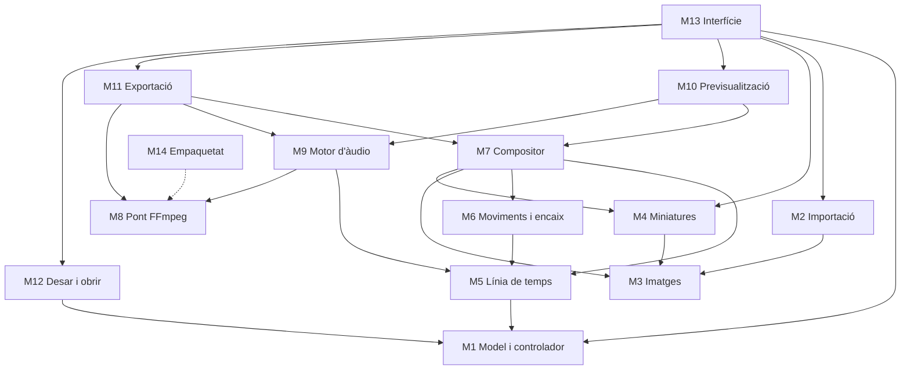
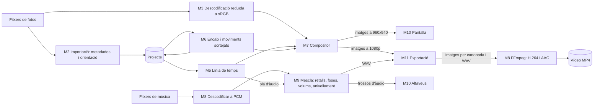
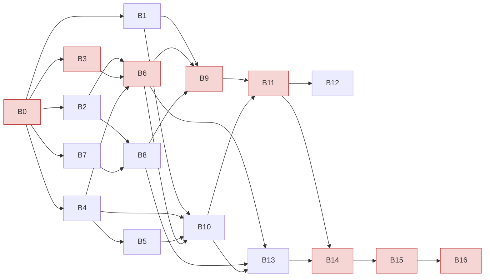

# PassiMaker: full de ruta i pla de desenvolupament

> Programa d'escriptori per a Windows per fer passis de fotos amb moviment de càmera, fosa encadenada i música. És l'equivalent de la funció de passi de fotos del Windows Movie Maker.
> Versió del pla: 1.0 · Data: 19/10/2026 · Estat: **pendent d'aprovació**
> Nom: **PassiMaker** (abans "Passi", canviat al M01, decisió 0006) · Fitxer de projecte: `.pmk` (M03, decisió 0009)

## Decisions preses al Pas 0

| Tema | Decisió |
|---|---|
| Ús | Intern de l'estudi, gratuït i no comercial. Es pot fer servir FFmpeg amb x264 (llicència GPL). |
| Distribució | ZIP portable: es descomprimeix i s'executa. Sense instal·lador ni signatura de codi (cost 0). |
| Sistema | Només Windows 10/11 de 64 bits. El nucli també es podrà provar a Linux. |
| Xarxa | Totalment fora de línia. |
| Volum | Fins a 1.000 fotos per projecte, de fins a 50 MP. |
| Maquinari mínim | PC d'oficina: 4 nuclis, 8 GB de RAM i gràfics integrats. |
| Sortida | MP4 Full HD (FHD) a 30 fps, horitzontal (1920×1080) o vertical (1080×1920), a triar per projecte. Sense 4K. Confirmat el 20/10/2026. |
| Dedicació | 4 h/setmana. |
| Desenvolupament | Claude Code en local a Windows, repositori privat a GitHub, CI amb GitHub Actions sobre Windows. |
| Tecnologia | Cap preferència. La recomanació és al Pas 2. |
| Idioma | Català, amb els textos en fitxers a part per poder-los traduir. |
| Lliurament | Xat i aquest fitxer, que serà el futur `docs/PLA.md`. |

**Com he interpretat "el més simple i de menor cost":** un ZIP portable, sense instal·lador ni certificat de signatura. Té dues conseqüències. (1) La primera vegada, Windows SmartScreen pot mostrar un avís ("Més informació → Executa igualment"). (2) Fer doble clic sobre un fitxer `.pmk` no l'obrirà automàticament. Es pot obrir des del programa, arrossegant-lo a la finestra o sobre `PassiMaker.exe`, o amb "Obre amb…" de Windows.

---

## Pas 1. Especificació funcional

### 1.0 Principis d'ús

- El camí normal té tres passos: **Fotos → Música → Exportar**. Tota la resta té valors per defecte pensats perquè el resultat quedi bé sense tocar res.
- Les opcions d'una foto o d'una cançó només apareixen quan se selecciona (panell de propietats). Les opcions poc habituals queden plegades a "Avançat".
- La finestra no es bloqueja mai mentre el programa treballa (importar, fer miniatures, analitzar la música). L'única excepció és l'exportació, que mostra un diàleg amb progrés.
- No es modifica mai cap fitxer original.

**Recorregut de referència (objectiu: menys de 5 minuts)**

| # | Acció de l'usuari | Què passa |
|---|---|---|
| 1 | Obre `PassiMaker.exe` | Pantalla buida amb el missatge "Arrossega aquí les fotos o la carpeta" i el botó [Tria fotos…] |
| 2 | Arrossega una carpeta amb 60 fotos | Les miniatures apareixen a poc a poc, ordenades per data. Cada foto ja té durada, encaix i moviment. |
| 3 | [+ Música] i tria 2 cançons | Les cançons surten a la franja de música. La barra d'estat avisa si la música i les fotos no duren el mateix. |
| 4 | [Ajustar a la música] (opcional) | Les durades de les fotos canvien perquè el passi acabi alhora que la música. |
| 5 | ▶ | Previsualització en temps real amb so |
| 6 | [Exportar vídeo] → nom | Barra de progrés. En acabar: [Obrir el vídeo] / [Mostrar a la carpeta] |

**Disposició de la finestra**

```
┌──────────────────────────────────────────────────────────────────────────────┐
│ [+ Fotos] [+ Música] [Ajustar a la música]  Format:[Horitzontal▾]  [Exportar vídeo] │
├──────────────────────────────────┬───────────────────────────────────────────┤
│  PREVISUALITZACIÓ                │  STORYBOARD (graella de miniatures)       │
│                                  │  ┌──┐ ┌──┐ ┌──┐ ┌──┐ ┌──┐ ┌──┐            │
│                                  │  │ 1│ │ 2│ │ 3│ │ 4│ │ 5│ │ 6│            │
│  |◀  ▶  ▶|   01:12 / 04:30       │  5,0s 5,0s 7,0s● 5,0s 5,0s 5,0s           │
│  ────────●───────────────        │  ...                                      │
├──────────────────────────────────┤                                           │
│  PROPIETATS (projecte / foto / cançó seleccionada)                           │
├──────────────────────────────────┴───────────────────────────────────────────┤
│  MÚSICA:  [1. Cançó A  3:12 ◢◣]  [2. Cançó B  2:40 ◢◣]   [+]                 │
├──────────────────────────────────────────────────────────────────────────────┤
│  124 fotos · 4:30  ·  Música 5:52  ⚠ La música dura 1:22 més [Ajustar]        │
└──────────────────────────────────────────────────────────────────────────────┘
```

**Valors per defecte globals**

| Paràmetre | Per defecte | Rang |
|---|---|---|
| Durada per foto | 5,0 s | 1–30 s (en passos de 0,5 s) |
| Fosa encadenada | 1,5 s | 0–3 s (0 = tall sec) |
| Fosa des de negre a l'inici | 1,0 s | 0–5 s (Avançat) |
| Fosa a negre al final | 2,0 s | 0–5 s (Avançat) |
| Moviment de càmera | Activat, automàtic | — |
| Intensitat | Mitjana | Suau / Mitjana / Marcada |
| Encaix | Automàtic | Automàtic / Omplir / Fons difuminat / Fons negre |
| Fosa d'entrada de cada cançó | Activada, 1,0 s | 0–10 s (en passos de 0,5 s) |
| Fosa de sortida de cada cançó | Activada, 3,0 s | 0–10 s |
| Fosa final si la música és més llarga | 3,0 s | Fixa |
| Volum general | 100 % | 0–100 % |
| Volum de cada cançó | 100 % | 0–150 % |
| Anivellament entre cançons | Activat (−16 LUFS) | Sí / no (Avançat) |
| Format | Horitzontal 1920×1080, 30 fps | Horitzontal / Vertical 1080×1920 |
| Codificació | H.264 High, CRF 18 · AAC 192 kbps, 48 kHz | Fixa |

### 1.1 Importar fotos

**Comportament**
- Es poden afegir fotos de tres maneres: arrossegant fitxers o carpetes a qualsevol lloc de la finestra, amb el botó [+ Fotos] (selecció múltiple) o amb el menú "Afegir una carpeta…".
- Si s'afegeix una carpeta, s'importen les fotos que conté. Si té subcarpetes amb fotos, el programa pregunta un sol cop: "Vols incloure també les subcarpetes (N fotos més)?".
- Formats: JPG/JPEG, PNG i HEIC/HEIF. L'HEIC és viable fora de línia amb una llibreria inclosa al programa. A més, i sense cost addicional, també BMP, TIFF, WebP i GIF (primer fotograma). Els fitxers RAW de càmera no s'admeten, i el programa ho diu clarament.
- L'orientació EXIF (els 8 valors) s'aplica sempre: a les miniatures, a la previsualització i al vídeo.
- Els perfils de color (Display P3 dels iPhone, Adobe RGB) es converteixen a sRGB perquè els colors no surtin apagats.
- Ordre:
  - Si com a mínim el 80 % de les fotos tenen data de captura EXIF, s'ordenen per data. Les que no en tenen, per la data del fitxer.
  - Si no, per nom en ordre natural ("IMG_2" abans que "IMG_10").
  - Les fotos noves van al final, o al punt on es deixen anar si s'arrosseguen sobre el storyboard.
  - El menú "Ordenar per data / per nom" les torna a ordenar totes.
- En importar-la, cada foto rep la durada general, l'encaix automàtic i un moviment sortejat.
- La importació és progressiva i es pot cancel·lar.

**Casos límit**

| Cas | Comportament |
|---|---|
| Fitxer corrupte o format no admès | No s'afegeix. Al final surt un resum: "2 fitxers no s'han pogut afegir [Veure quins]". |
| Foto que ja és al projecte | Una sola pregunta per a tota la importació: "3 fotos ja hi són. Les vols afegir igualment?" (per defecte, no). |
| Foto petita (costat curt < 540 px en 1080p) | S'importa amb una icona de "baixa resolució". El moviment es redueix o s'anul·la perquè no es vegi pixelada. |
| Foto minúscula (< 64 px) | No s'afegeix, amb un missatge. |
| Foto enorme (50–100 MP) | S'afegeix. Només es descodifica a la mida necessària. |
| Panoràmica (p. ex. 3:1) o vertical | Encaix automàtic amb fons difuminat (vegeu 1.6). |
| PNG amb transparència | Es compon sobre negre. |
| CMYK, 16 bits, escala de grisos | Es converteixen a RGB de 8 bits. |
| Més de 1.000 fotos | S'admeten, amb l'avís "Més de 1.000 fotos: el programa pot anar més lent". |
| Fitxers de OneDrive "només en línia" | Es descarreguen en llegir-los. La importació mostra el progrés i es pot cancel·lar. |

**Com ho veu l'usuari:** les miniatures apareixen una darrere l'altra, amb el comptador "Important 340 de 1.000…" i un botó [Cancel·lar].

### 1.2 Storyboard

**Comportament**
- Les miniatures formen una graella que s'adapta a l'amplada (com al Movie Maker 2012), en l'ordre del passi. Sota cada miniatura hi ha el número d'ordre i la durada ("5,0 s"). Unes icones petites indiquen el tipus de moviment, si té una durada personalitzada, si és de baixa resolució o si no es troba el fitxer.
- Selecció simple, múltiple (Ctrl, Maj) i de totes (Ctrl+A).
- Per reordenar, s'arrosseguen una o diverses fotos. Una línia vertical indica on aniran. Amb el teclat: Ctrl+← i Ctrl+→.
- Per eliminar: tecla Supr, botó o menú contextual. Només es demana confirmació si se n'eliminen 5 o més. Es manté encara que hi hagi "desfer" (P1, decisió 0007).
- Per duplicar: Ctrl+D o menú contextual. La còpia va just després de l'original, amb la mateixa durada i el mateix encaix però amb un moviment nou i diferent.
- Mida de les miniatures: petita, mitjana o gran.
- En fer clic sobre una miniatura, la previsualització salta a l'inici d'aquella foto i el panell de propietats en mostra els ajustos.

**Casos límit:**
- 0 fotos: estat buit amb instruccions.
- 1 foto: el passi és vàlid.
- 1.000 fotos: el desplaçament és fluid (només es dibuixen les miniatures visibles) i les miniatures es carreguen començant per les que es veuen.
- Foto no trobada: miniatura grisa amb una icona i l'opció "Cercar…".

### 1.3 Durada per foto

- La durada general és de 5,0 s (de 1 a 30 s, en passos de 0,5 s). Si es canvia, afecta totes les fotos que no tenen una durada personalitzada.
- Per a una foto, o per a les fotos seleccionades, hi ha el camp "Durada" al panell de propietats. Si es modifica, la foto queda marcada com a personalitzada (amb una icona) i apareix el botó [Restablir a la general].
- La durada és l'espai que ocupa la foto a la línia de temps, des de la meitat de la fosa anterior fins a la meitat de la següent. Així, la durada total del passi és exactament la suma de les durades de totes les fotos.
- La barra d'estat mostra sempre el total ("124 fotos · 10:20").
- Cas límit: si una foto dura menys que dues foses, la fosa d'aquella foto s'escurça automàticament (vegeu 1.4).

### 1.4 Transició de fosa

- Hi ha una fosa encadenada entre cada parella de fotos consecutives, amb una durada global d'1,5 s (de 0 a 3 s; 0 = tall sec). No hi ha cap altre tipus de transició.
- A l'inici hi ha una fosa des de negre (1,0 s) i al final una fosa cap a negre (2,0 s). Totes dues es poden ajustar a "Avançat" (de 0 a 5 s).
- La fosa queda centrada en el canvi de foto: comença 0,75 s abans i acaba 0,75 s després. Durant la fosa, les dues fotos continuen movent-se; el moviment no s'atura mai.
- Regla de seguretat: la fosa entre dues fotos no pot durar més de la meitat de la més curta. Així, cada foto té un moment en què es veu sencera.
- Casos límit:
  - 1 sola foto: només hi ha la fosa d'entrada i la de sortida.
  - Passi més curt que les foses d'inici i final sumades: les dues foses s'escurcen proporcionalment.

### 1.5 Moviment de càmera (efecte Ken Burns)

**Tipus de moviment**

| Tipus | Descripció |
|---|---|
| Apropar | Zoom endavant cap a un punt proper al centre, una mica més amunt, que és on solen ser les cares |
| Allunyar | Zoom enrere des d'un punt proper al centre |
| Desplaçar ← → ↑ ↓ | Desplaçament horitzontal o vertical amb un zoom fix lleuger, que deixa marge per moure's |
| Combinat | Zoom (endavant o enrere) amb un desplaçament suau en diagonal |
| Cap | Foto estàtica |

**Intensitat global** (són valors proposats, per validar a la fita F1)

| | Suau | Mitjana (per defecte) | Marcada |
|---|---|---|---|
| Variació del zoom en una foto | 6 % | 12 % | 20 % |
| Desplaçament (en % del costat) | 4 % | 8 % | 13 % |
| Velocitat màxima del zoom | 2 %/s | 3,5 %/s | 5 %/s |
| Velocitat màxima del desplaçament | 1,5 %/s | 2,5 %/s | 4 %/s |

- El moviment és lineal i continu durant tot el temps que la foto és visible, foses incloses, sense acceleracions ni aturades. El zoom es calcula perquè la velocitat aparent sigui constant.
- Si una foto és molt curta, el moviment es redueix perquè no sigui brusc. Si és molt llarga, simplement va més lent.

**Mode automàtic aleatori (per defecte)**
- Probabilitats de partida: Apropar 30 %, Allunyar 25 %, Desplaçar 25 %, Combinat 20 %.
- Regles d'equilibri:
  1. No es repeteix mai el mateix tipus i la mateixa direcció en dues fotos seguides.
  2. No hi pot haver més de 2 fotos seguides de la mateixa família (zoom o desplaçament).
  3. En qualsevol grup de 6 fotos consecutives, la diferència entre fotos que s'apropen i fotos que s'allunyen no supera 2.
  4. La primera foto s'apropa suaument i l'última s'allunya, que és l'inici i el final clàssics.
  5. Els desplaçaments van, sempre que es pot, en la direcció en què la foto té més marge (per exemple, en vertical per a una foto 4:3 dins un vídeo 16:9).
- Els resultats són reproduïbles. El projecte desa una llavor i cada foto un comptador de sorteigs, de manera que el mateix projecte dona sempre el mateix vídeo. El moviment resultant també es desa al projecte, i per això afegir o reordenar fotos no canvia el moviment de les altres.
- Reordenar no torna a sortejar els moviments, perquè els que ja s'han vist no canviïn. Si en reordenar queden dos moviments iguals seguits, no es corregeix sol; [Tornar a sortejar tots] ho arregla.

**Control manual**
- Al panell de la foto hi ha "Moviment: [Automàtic ▾]", amb les opcions Apropar, Allunyar, Desplaçar (4 direccions), Combinat i Cap. Si se'n tria una, el moviment queda fixat (mode manual).
- El botó [🎲 Tornar a sortejar] torna a sortejar la foto o les fotos seleccionades.
- [Tornar a sortejar tots] torna a sortejar totes les fotos en mode automàtic i respecta les que s'han fixat a mà. Al menú hi ha [Restablir tots a automàtic].
- També hi ha un interruptor global "Moviment de càmera" (activat per defecte) i el selector d'intensitat.

**Garantia que no es veuran vores**
- La part que es veu és sempre una finestra amb la proporció del vídeo que queda tota dins la imatge, o dins del llenç amb fons difuminat. Es comprova a l'inici, al final i en els instants intermedis. Si un moviment no ho compleix, s'ajusta abans d'acceptar-lo.
- Fotos de baixa resolució: el zoom es limita perquè la foto no s'ampliï més d'1,5 vegades la seva resolució original. Si la foto fa menys del 50 % de la resolució del vídeo, el moviment passa automàticament a "Cap".

### 1.6 Fotos verticals i proporcions diferents

**Proposta: encaix automàtic mixt**
- **Omplir** si la proporció de la foto s'acosta a la del vídeo (relació entre 0,70 i 1,43, que inclou 4:3, 3:2, 16:9 i 16:10). Es retalla el mínim possible i la part retallada serveix de marge per al moviment.
- **Encaixar amb fons difuminat** si la proporció és molt diferent: fotos verticals en un vídeo horitzontal, horitzontals en un vídeo vertical, quadrades i panoràmiques. La foto es veu sencera i el fons és la mateixa foto ampliada, molt desenfocada i enfosquida un 30 %. El moviment s'aplica al conjunt (foto i fons), només de tipus zoom i amb el 60 % de la intensitat.
- **Per què:**
  - Retallar una foto vertical per a un vídeo horitzontal en fa perdre més del 60 % (per exemple, caps tallats).
  - Les franges negres semblen justament les zones buides que volem evitar.
  - El fons difuminat és el que es fa servir avui a mòbils i televisió.
- Per a cada foto es pot forçar una opció: Automàtic, Omplir, Encaixar amb fons difuminat o Encaixar amb fons negre.
- En format vertical (9:16) s'apliquen les mateixes regles, a l'inrevés.
- Casos límit:
  - Panoràmica 4:1 en mode "Omplir": es veu la franja central, amb un desplaçament lateral limitat per la velocitat màxima.
  - Foto quadrada en un vídeo horitzontal: fons difuminat.
  - Foto vertical 3:4 en un vídeo vertical: Omplir.

### 1.7 Música

**Comportament**
- Sota el storyboard hi ha la franja "Música", amb les cançons en ordre: nom, durada real (després del retall) i indicadors de fosa. Les cançons s'afegeixen amb [+ Música] o arrossegant fitxers d'àudio a la finestra. Es poden eliminar i reordenar arrossegant-les.
- Formats: MP3, WAV, M4A/AAC, FLAC, OGG, WMA i OPUS.
- Les cançons sonen una darrere l'altra des del principi del vídeo, sense trepitjar-se.
- Ajustos de cada cançó (panell de propietats):
  - Fosa d'entrada: ☑ activada, 1,0 s (de 0 a 10 s, en passos de 0,5 s).
  - Fosa de sortida: ☑ activada, 3,0 s (de 0 a 10 s).
  - Retall: "Comença a" i "Acaba a", amb una barra que mostra la forma d'ona i té dues nanses, i un botó per escoltar el tros triat.
  - Volum: 100 % (de 0 a 150 %).
- Volum general: 100 % (de 0 a 100 %).
- Anivellament automàtic (activat per defecte, a "Avançat"): iguala el volum percebut de totes les cançons (−16 LUFS) perquè no n'hi hagi cap de molt més forta que les altres.
- Encara que les foses estiguin desactivades, cada tall té una fosa de 10 ms, que no se sent però evita els espetecs.
- Les foses segueixen una corba logarítmica, que a l'oïda sona més natural que una de lineal.

**Ajustar a la música**
- El botó [Ajustar a la música] torna a calcular les durades perquè el passi duri exactament el mateix que la música (la suma de les cançons, ja retallades). Es mantenen les proporcions: una foto de 10 s continua durant el doble que una de 5 s.
- Cada foto ha de durar entre 1 i 30 s. Si cada foto hagués de durar menys de 2 s, surt l'avís "Hi ha massa fotos per a aquesta música: cada foto duraria 0,8 s. Afegeix música o treu fotos.", amb [Aplicar igualment] i [Cancel·lar].
- Casella "Mantenir ajustat" (desactivada per defecte): si s'activa, el passi es torna a ajustar sol cada vegada que s'afegeixen fotos o cançons.

**Quan la música i les fotos no duren el mateix**

| Situació | Comportament per defecte | Com ho veu l'usuari |
|---|---|---|
| La música dura més que el passi | La música es talla amb una fosa de volum de 3 s que acaba just amb la fosa a negre del vídeo | Avís discret a la barra d'estat: "La música dura 1:22 més. [Ajustar a la música]" |
| La música dura menys que el passi | Després de l'última cançó (amb la seva fosa de sortida) hi ha silenci | "La música s'acaba 0:45 abans. [Ajustar a la música]" |
| No hi ha música | Vídeo amb una pista d'àudio en silenci, perquè sigui més compatible amb els televisors | — |

**Casos límit:**
- Cançó corrupta o protegida (DRM): es marca en vermell, amb un missatge, i no entra a la mescla.
- Cançó més curta que les seves dues foses: cada fosa es redueix al 40 % de la durada de la cançó.
- Retall amb l'inici després del final: no es permet.
- Àudio mono, 5.1 o amb freqüències de mostreig diferents: es converteix a estèreo de 48 kHz.
- Música de més d'una hora: s'admet.

### 1.8 Previsualització

- Panell amb la imatge del passi i aquests controls: ▶/❚❚ (barra espaiadora), foto anterior i següent (← →), barra de temps clicable i temps actual / total.
- Es reprodueix en temps real i amb so, a resolució reduïda (fins a 960×540, o 540×960 en vertical). La imatge és exactament la mateixa que s'exportarà, perquè la fa el mateix motor.
- En fer clic sobre una miniatura, la previsualització salta a l'inici d'aquella foto (i, si s'estava reproduint, continua des d'allà).
- Qualsevol canvi (durada, moviment, encaix, música) es veu a l'instant. En pausa, la imatge es torna a dibuixar.
- Casos límit:
  - Ordinador lent: se salten imatges, però el so no es talla mai i la imatge no queda endarrerida.
  - 1.000 fotos: la reproducció comença des de qualsevol punt en menys de mig segon.
  - Projecte sense música: es fa servir un rellotge intern.

### 1.9 Exportar

- [Exportar vídeo] obre el diàleg de desar, amb el nom del projecte i la carpeta Vídeos ja proposats. No hi ha cap altra opció: el format (horitzontal o vertical) és el del projecte.
- Vídeo: MP4, H.264 perfil High, 1920×1080 o 1080×1920, 30 fps, qualitat alta constant (CRF 18), espai de color BT.709.
- Àudio: AAC a 192 kbps, 48 kHz, estèreo.
- El fitxer es pot començar a reproduir abans d'haver-se descarregat del tot (opció faststart).
- Diàleg de progrés: barra, percentatge, temps restant estimat i [Cancel·lar]. Si es cancel·la, l'exportació s'atura en menys de 2 s i el fitxer a mig fer s'esborra.
- Durant l'exportació no es pot editar (finestra modal) i l'ordinador no entra en repòs.
- En acabar, surt "Vídeo desat (4:30, 245 MB)" amb [Obrir el vídeo] i [Mostrar a la carpeta].
- Objectiu de velocitat: al PC de referència, exportar no ha de trigar més del triple de la durada del vídeo (decisió 0008). La previsualització, en canvi, és sempre en temps real (§1.8).
- Casos límit:
  - Disc ple: abans de començar es comprova si hi ha prou espai (estimat). Si el disc s'omple durant l'exportació, surt un missatge clar i s'esborra el fitxer a mig fer.
  - Ja existeix un fitxer amb aquest nom: es demana si es vol substituir.
  - Fotos o cançons que no es troben: no s'exporta i se'n mostra la llista.
  - Rutes amb accents o molt llargues: s'admeten.
  - El vídeo s'escriu amb un nom provisional i es reanomena en acabar.

### 1.10 Desar i obrir projectes

- El projecte es desa en un fitxer `.pmk` (text estructurat i llegible) amb tots els ajustos i les rutes de les fotos i les cançons. Els fitxers originals no es copien.
- Desar (Ctrl+S), Desar com a…, Obrir (Ctrl+O) i llista de projectes recents a la pantalla inicial. El títol de la finestra mostra el nom del projecte, amb un asterisc si hi ha canvis sense desar. En tancar, el programa pregunta si es volen desar.
- Cada 2 minuts es fa una còpia de recuperació, fora de la carpeta del projecte. Si el programa es tanca de cop, en tornar-lo a obrir ofereix recuperar el projecte.
- Les rutes es desen de dues maneres: relatives al fitxer del projecte i absolutes. Si es mou tota la carpeta (projecte i fotos), el projecte continua funcionant.
- Fitxers que no es troben: "No es troben 12 fitxers. [Cercar en una carpeta…]". El programa els torna a enllaçar automàticament pel nom.
- El format porta un número de versió. Si s'obre un projecte fet amb una versió més nova del programa, surt un missatge clar en lloc d'una fallada.
- Casos límit:
  - Fitxer de projecte malmès: surt un missatge i, si hi ha còpia de recuperació, s'ofereix.
  - Projecte obert des d'una memòria USB amb una altra lletra d'unitat: funciona gràcies a les rutes relatives.

### 1.11 Format del vídeo

- Ajust del projecte "Format: Horitzontal 16:9 / Vertical 9:16" (per defecte, horitzontal), a la barra d'eines.
- Si es canvia, el programa torna a calcular l'encaix automàtic i el moviment de totes les fotos, mantenint el tipus de moviment triat. La previsualització canvia de forma.

### 1.12 Propostes separades (fora del pla)

| # | Proposta | Per què | Impacte | Recomanació |
|---|---|---|---|---|
| P1 | Desfer / Refer (Ctrl+Z) | El Movie Maker en tenia, i un usuari sense experiència ho espera | +1 sessió si s'inclou des del principi. El model ja es dissenya amb "ordres" per facilitar-ho. | **Incloure-la** |
| P2 | Girar una foto 90° a mà | Fotos escanejades o amb l'EXIF incorrecte | +0,5 sessions | **Incloure-la** |
| P3 | Títol inicial i crèdits finals senzills | El Movie Maker en tenia i s'usaven molt en els passis | +2 o 3 sessions | Per a la v1.1 |
| P4 | Punt d'interès o detecció de cares per orientar el zoom | Millora la qualitat del moviment automàtic | +2 sessions | Per a la v1.1 |
| P5 | "Desar el projecte amb les fotos" en una carpeta | Per portar el projecte a un altre ordinador | +1 sessió | Opcional |
| P6 | Instal·lador amb associació de fitxers `.pmk` | Doble clic per obrir projectes | +1 sessió (i un certificat opcional de 200–400 €/any) | No, de moment |

---

## Pas 2. Arquitectura i funcions internes

### 2.1 Opcions de tecnologia

| | **A. Python + Qt (PySide6) + NumPy/OpenCV + FFmpeg** | **B. C# .NET 8 + WPF + SkiaSharp + FFmpeg** | **C. Tauri o Electron + WebGL + FFmpeg** |
|---|---|---|---|
| Interfície | Qt 6: madura, amb vistes pensades per a llistes llargues (1.000 miniatures) i arrossegar i deixar anar inclòs | WPF: nativa de Windows i molt bona | HTML/CSS: molt flexible |
| Composició de les imatges | NumPy + OpenCV a la CPU (posicionament per sota del píxel i diversos nuclis) | SkiaSharp / Direct2D | WebGL a la targeta gràfica |
| El mateix motor per previsualitzar i exportar | Sí, el mateix codi | Sí | Difícil: exportar des de WebGL exigeix un navegador ocult o un segon motor |
| Codificació del vídeo | FFmpeg extern alimentat per canonada (x264 + AAC) | Igual | Igual |
| Proves automàtiques d'imatge i so | Excel·lents: pytest + NumPy analitzen imatges i mostres d'àudio directament, i pytest-qt prova la interfície | Bones (xUnit), però analitzar imatge i àudio costa més i les proves d'interfície (FlaUI) són fràgils | Dues bases de proves (Rust/JS). Provar WebGL és complicat. |
| Fiabilitat amb Claude Code | Molt alta (és el llenguatge on és més fiable) | Alta | Mitjana-alta |
| Rendiment al PC de referència | Suficient: ~5–10 ms per imatge a 960×540 i ~20–35 ms a 1080p. Amb diversos fils, exportar és com a mínim igual de ràpid que reproduir. | Molt bo | Previsualització excel·lent, però exportació complexa |
| Proves a Linux | Sí: el nucli i la interfície (en mode sense pantalla) | El nucli sí, WPF no | Parcialment |
| Mida del ZIP | 180–250 MB | 120–180 MB | 150–250 MB |
| Llicències | PySide6 LGPL, OpenCV Apache, FFmpeg GPL (vàlid per a ús intern) | Permissives, més FFmpeg | Permissives, més FFmpeg |
| Riscos principals | Rendiment de la CPU en PCs molt modestos; mida del ZIP | Proves menys automatitzables; només Windows | Dos motors d'imatge; més peces |

**Recomanació: opció A.** Raons:
1. **El mateix motor per previsualitzar i exportar.** El que es veu és el que s'exporta.
2. **Proves automàtiques visuals i d'àudio molt naturals.** És el que permet que Claude Code verifiqui la feina sol.
3. **És la tecnologia en què Claude Code és més fiable.**
4. **Rendiment suficient per a 1080p** al PC de referència, si se segueixen dues estratègies: descodificar les fotos només a la mida necessària i previsualitzar a resolució reduïda.

**Pila concreta:** Python 3.12 · uv (entorns i dependències fixades) · PySide6 · NumPy · OpenCV (versió sense interfície) · Pillow + pillow-heif (HEIC) · sounddevice (reproducció d'àudio amb un rellotge precís) · FFmpeg 7.x estàtic (ffmpeg.exe i ffprobe.exe, amb la versió i la suma de verificació fixades) · PyInstaller (carpeta portable) · pytest, pytest-qt, Hypothesis (proves de propietats), ruff (estil), pyright (tipus).

**Principis d'arquitectura**
1. **Nucli independent de la interfície.** Tot el que no és pantalla (model, línia de temps, moviments, composició, àudio i exportació) no depèn de Qt i es pot provar i executar des de la línia d'ordres.
2. **Un sol motor de composició** per a la previsualització i per a l'exportació.
3. **Funcions deterministes.** El mateix projecte amb la mateixa llavor genera sempre exactament les mateixes imatges.
4. **Un sol punt de modificació del projecte:** un controlador que treballa amb "ordres", avisa la interfície de cada canvi i deixa preparat el "desfer".
5. **Unitats fixes:** el temps en segons, les imatges en RGB de 8 bits i les finestres de moviment amb coordenades normalitzades (de 0 a 1) respecte del llenç.

### 2.2 Mòduls

| # | Mòdul | Responsabilitat | Depèn de |
|---|---|---|---|
| M1 | Model i controlador | Dades del projecte i únic punt de modificació | — |
| M2 | Importació i metadades | Trobar, validar i ordenar fotos; llegir l'EXIF | M3 |
| M3 | Descodificació i memòria cau d'imatges *(afegit)* | Servir imatges orientades, en sRGB i a la mida justa | — |
| M4 | Miniatures i intermedis | Miniatures (256 px) i còpies intermèdies (1.600 px) desades a disc | M3 |
| M5 | Línia de temps | Instants de cada foto, foses i pla d'àudio | M1 (dades) |
| M6 | Moviments i encaix | Encaix automàtic i moviments sortejats sense vores | M5 |
| M7 | Compositor | Imatge RGB de qualsevol instant | M3, M4, M5, M6 |
| M8 | Pont FFmpeg *(afegit)* | Tota la comunicació amb ffmpeg.exe i ffprobe.exe | — |
| M9 | Motor d'àudio | Mescla, foses, volums i anivellament | M5, M8 |
| M10 | Previsualització | Reproducció en temps real sincronitzada | M4, M5, M7, M9 |
| M11 | Exportació | MP4 amb progrés i cancel·lació; ordres de línia | M5, M7, M8, M9 |
| M12 | Desar i obrir | Format `.pmk`, recuperació, reenllaç de fitxers | M1 |
| M13 | Interfície | Finestres, panells, diàlegs i traduccions | M1, M2, M4, M10, M11, M12 |
| M14 | Empaquetat | ZIP portable i autoprova (eina de construcció) | tots |

**Mòduls afegits:**
- **M3** perquè el comparteixen les miniatures, la previsualització i l'exportació, i és clau per suportar 1.000 fotos de 50 MP.
- **M8** perquè les canonades, les finestres de consola i les rutes Unicode de Windows són una font clàssica d'errors. Concentrar-ho tot en un sol lloc permet provar-ho a fons.

**Fitxa de cada mòdul**

**M1 · Model i controlador**
- *Entrades → sortides:* ordres d'edició → projecte actualitzat i avisos de canvi ("fotos canviades", "temps canviat", "música canviada").
- *Funcions internes:*
  - representar el projecte, les fotos, les cançons i els ajustos;
  - validar els valors i limitar-los als rangs;
  - aplicar les ordres (cadascuna sap desfer-se, pensant en P1);
  - avisar els observadors;
  - marcar si hi ha canvis sense desar;
  - assignar un identificador únic a cada foto.
- *Depèn de:* res.
- *Riscos:* que la interfície modifiqui el model sense passar pel controlador. Ho evita una regla al CLAUDE.md i una prova que ho detecta.

**M2 · Importació i metadades**
- *Entrades → sortides:* rutes de fitxers o carpetes → fotos candidates amb metadades (amplada i alçada ja orientades, orientació, data, perfil de color i estat d'error), ordenades.
- *Funcions internes:*
  - explorar carpetes;
  - filtrar per extensió i pel contingut real;
  - llegir les capçaleres sense descodificar tota la imatge;
  - llegir l'EXIF;
  - ordenar per data o per nom natural;
  - detectar duplicats;
  - informar del progrés i permetre cancel·lar.
- *Depèn de:* M3.
- *Riscos:* variants rares d'HEIC, EXIF mal format, fitxers al núvol lents.

**M3 · Descodificació i memòria cau d'imatges**
- *Entrades → sortides:* una foto i la mida mínima necessària → imatge RGB en sRGB, orientada, a aquesta mida o una mica més gran.
- *Funcions internes:*
  - descodificació reduïda (els JPEG es poden descodificar directament a 1/2, 1/4 o 1/8);
  - aplicar l'orientació;
  - convertir el perfil de color a sRGB;
  - convertir CMYK, 16 bits i transparència;
  - memòria cau a la RAM amb un límit (768 MB per defecte) que descarta primer el que fa més temps que no es fa servir;
  - precàrrega en paral·lel de les fotos que vindran.
- *Depèn de:* res.
- *Riscos:* memòria amb fotos enormes; HEIC lent (no admet descodificació reduïda), cosa que compensen els intermedis de M4.

**M4 · Miniatures i intermedis**
- *Entrades → sortides:* una foto → miniatura (256 px) i intermedi (1.600 px) a la memòria cau de disc.
- *Funcions internes:*
  - identificar cada fitxer per ruta, data de modificació i mida;
  - aprofitar la miniatura EXIF incrustada quan és prou gran;
  - generar en segon pla, començant per les miniatures visibles;
  - limitar l'espai de disc (2 GB) i esborrar primer les més antigues;
  - regenerar si el fitxer canvia.
- *Depèn de:* M3.
- *Riscos:* amb 1.000 fotos HEIC, la primera vegada és lenta (~1–2 min); es mostra el progrés.

**M5 · Línia de temps**
- *Entrades → sortides:* durades en ordre, ajustos de fosa i cançons → la línia de temps:
  - durada total;
  - per a cada foto, l'inici i el final del seu espai i del temps en què és visible, i els intervals de fosa;
  - foses de negre;
  - **pla d'àudio:** on comença i acaba cada cançó dins el vídeo i quin tros de l'original sona.
- *Funcions internes:*
  - calcular l'espai de cada foto;
  - limitar les foses;
  - respondre "què es veu a l'instant t": les fotos visibles, amb la seva opacitat i el progrés del moviment (de 0 a 1);
  - calcular l'ajust a la música;
  - comparar la durada de les fotos i de la música per als avisos;
  - convertir temps en número de fotograma i a l'inrevés.
- *Depèn de:* M1 (només les dades).
- *Riscos:* errors d'arrodoniment al límit entre fotogrames. Per evitar-los, l'exportació treballa amb fotogrames enters.

**M6 · Moviments i encaix**
- *Entrades → sortides:* dimensions de la foto, format, preferència d'encaix, intensitat, llavor, moviments de les fotos veïnes i comptador de sorteigs → encaix final i moviment final (tipus i finestra inicial i final dins el llenç).
- *Funcions internes:*
  - decidir l'encaix automàtic segons la proporció;
  - definir el llenç (la foto, o el conjunt amb el fons difuminat);
  - sortejar el tipus de moviment seguint les regles d'equilibri;
  - triar el punt focal i la direcció segons el marge;
  - calcular l'amplitud segons la intensitat, la durada i la velocitat màxima;
  - limitar el moviment a les fotos de baixa resolució;
  - comprovar que la finestra no surt mai del llenç;
  - recalcular-ho tot si canvia el format.
- *Depèn de:* M5 (temps visible de cada foto).
- *Riscos:* moviments que marejin o que es repeteixin massa. Es validarà mirant-los a la fita F1.

**M7 · Compositor**
- *Entrades → sortides:* línia de temps, moviments, imatges (M3/M4), un instant i una mida → imatge RGB d'aquell instant.
- *Funcions internes:*
  - construir i guardar el llenç de cada foto (el fons difuminat es calcula sobre una còpia petita, que és ràpid);
  - triar la resolució d'origen adequada;
  - moure i escalar la imatge amb precisió per sota del píxel, que evita el tremolor en els desplaçaments lents;
  - barrejar les dues fotos durant la fosa;
  - aplicar les foses de negre;
  - **mode de prova amb "color sentinella":** pinta de magenta qualsevol zona de fora de la imatge, perquè les proves la detectin.
- *Depèn de:* M3, M4, M5, M6.
- *Riscos:* rendiment a 1080p; tremolor si s'ha de reduir molt una imatge gran (cal partir d'una imatge d'origen de mida adequada).

**M8 · Pont FFmpeg**
- *Entrades → sortides:* peticions dels altres mòduls → informació dels fitxers, àudio descodificat, vídeo codificat i mesures.
- *Funcions internes:*
  - localitzar ffmpeg.exe i ffprobe.exe;
  - llegir les característiques d'un fitxer (durada, pistes);
  - descodificar l'àudio a PCM de 48 kHz estèreo i desar-lo a la memòria cau;
  - mesurar la sonoritat (LUFS i pic);
  - codificar el vídeo rebent les imatges per una canonada i l'àudio en WAV;
  - interrompre la codificació netament;
  - extreure imatges i àudio d'un vídeo (per a les proves);
  - calcular la forma d'ona.
- *Depèn de:* res.
- *Riscos:* bloquejos de les canonades a Windows, finestres de consola i rutes Unicode. Tenen proves específiques.

**M9 · Motor d'àudio**
- *Entrades → sortides:* cançons, pla d'àudio, volums i ajustos → una font d'àudio que retorna qualsevol tros de la mescla, i el WAV final.
- *Funcions internes:*
  - descodificar cada cançó una sola vegada a la memòria cau de disc i llegir-la directament des del disc (accés immediat a qualsevol instant amb poca RAM);
  - calcular el guany d'anivellament;
  - aplicar el retall, les foses amb corba logarítmica, les foses de 10 ms als talls, el volum de cada cançó i el general, i la fosa final;
  - aplicar un limitador de seguretat contra la saturació;
  - generar el WAV per trossos.
- *Depèn de:* M5, M8.
- *Riscos:* projectes de més d'una hora (tot es fa per trossos i mai no es té la mescla sencera a la memòria); espai de disc de la memòria cau (~10 MB per minut).

**M10 · Previsualització**
- *Entrades → sortides:* projecte, línia de temps, compositor i font d'àudio → imatges a la pantalla sincronitzades amb el so, i l'estat (reproduint, temps actual, foto actual).
- *Funcions internes:*
  - reproduir l'àudio amb sounddevice i fer-lo servir de **rellotge mestre**;
  - un fil que demana al compositor la imatge de l'instant que marca el rellotge, a resolució reduïda;
  - saltar imatges si va tard;
  - anar a un instant o a una foto;
  - precarregar els intermedis de les fotos que vindran;
  - tornar a dibuixar la imatge en pausa quan hi ha un canvi;
  - fer servir un rellotge intern si no hi ha música.
- *Depèn de:* M4, M5, M7, M9.
- *Riscos:* fluïdesa amb gràfics integrats; desincronització. Es prova amb un rellotge simulat.

**M11 · Exportació**
- *Entrades → sortides:* projecte, ruta de destí, avís de progrés i senyal de cancel·lació → MP4 i resultat (correcte, cancel·lat o error amb motiu).
- *Funcions internes:*
  - comprovar que hi són tots els fitxers i que hi ha espai al disc;
  - generar l'àudio en un WAV provisional;
  - cadena de fils: precàrrega d'imatges → composició → enviament a FFmpeg;
  - progrés i temps restant;
  - cancel·lació;
  - nom provisional i canvi de nom en acabar;
  - impedir que l'ordinador entri en repòs;
  - **ordres de línia:** crear un projecte a partir d'una carpeta (`passimaker-nou`) i exportar-lo (`passimaker-render`).
- *Depèn de:* M5, M7, M8, M9.
- *Riscos:* memòria i velocitat amb 1.000 fotos; que la cancel·lació deixi restes.

**M12 · Desar i obrir**
- *Entrades → sortides:* un projecte → un fitxer `.pmk`, i a l'inrevés, amb la llista de fitxers que no es troben.
- *Funcions internes:*
  - escriptura segura: es desa en un fitxer provisional i després es reanomena;
  - versió del format i conversió de versions antigues;
  - rutes relatives i absolutes;
  - còpia de recuperació;
  - reenllaç de fitxers a partir d'una carpeta.
- *Depèn de:* M1.
- *Riscos:* fitxer malmès si el programa es tanca de cop; l'escriptura segura ho evita.

**M13 · Interfície**
- *Entrades → sortides:* accions de l'usuari i avisos del controlador → ordres al controlador i vistes actualitzades.
- *Funcions internes:*
  - finestra principal i estat buit;
  - storyboard que només dibuixa les miniatures visibles;
  - arrossegar i deixar anar (fitxers i reordenació);
  - panells de propietats (projecte, foto, cançó);
  - franja de música;
  - barra d'estat amb durades i avisos;
  - diàlegs d'exportació, desar/obrir, recuperació i reenllaç;
  - dreceres de teclat;
  - textos traduïbles.
- *Depèn de:* M1, M2, M4, M10, M11, M12.
- *Riscos:* que la finestra es bloquegi. Tot el que és lent es fa en un fil a part.

**M14 · Empaquetat**
- *Funcions:*
  - crear la carpeta portable amb PyInstaller;
  - afegir FFmpeg, la icona i la versió;
  - crear el ZIP;
  - autoprova (`PassiMaker.exe --autoprova`): exporta un vídeo curt sense obrir la finestra.
- *Riscos:* falsos positius dels antivirus; mida del ZIP.

### 2.3 Contractes de dades (pseudollenguatge)

**Estructures**

| Estructura | Camps |
|---|---|
| **Projecte** | versió_format · nom · format (HORITZONTAL \| VERTICAL) · llavor · durada_general_s · fosa_encadenada_s · fosa_inici_s · fosa_final_s · moviment_activat · intensitat (SUAU \| MITJANA \| MARCADA) · fotos: llista de Foto · música: Música |
| **Foto** | id · ruta · ruta_relativa · amplada, alçada (ja orientades) · orientació_exif · data_captura (opcional) · durada_s (buida = durada general) · encaix_preferit (AUTO \| OMPLIR \| DIFUMINAT \| NEGRE) · moviment: MovimentFoto · baixa_resolució |
| **MovimentFoto** | mode (AUTO \| MANUAL) · tipus (APROPAR \| ALLUNYAR \| DESPLAÇAR_ESQ \| DESPLAÇAR_DRE \| DESPLAÇAR_AMUNT \| DESPLAÇAR_AVALL \| COMBINAT \| CAP) · comptador_sorteig · finestra_inicial, finestra_final: Finestra · encaix_resolt |
| **Finestra** | centre_x, centre_y (de 0 a 1 sobre el llenç) · escala (1 = la finestra més gran que hi cap) |
| **Música** | volum_general (0–1) · anivellar · mantenir_ajustat · cançons: llista de Cançó |
| **Cançó** | id · ruta · ruta_relativa · durada_original_s · retall_inici_s · retall_final_s · fosa_entrada (activa, segons) · fosa_sortida (activa, segons) · volum (0–1,5) · guany_anivellament_db (calculat) |
| **LíniaDeTemps** | durada_total_s · fotogrames_totals · espais: llista de {foto_id, inici_espai, final_espai, inici_visible, final_visible, fosa_entrada (inici, final), fosa_sortida (inici, final)} · fosa_negre_inici · fosa_negre_final · pla_àudio |
| **PlaÀudio** | llista de {cançó_id, inici_al_vídeo, final_al_vídeo, inici_a_l'original, fosa_entrada_s, fosa_sortida_s} · fosa_final_extra_s |
| **Visibles** (resposta a "què es veu a t") | llista de {foto_id, opacitat 0–1, progrés_moviment 0–1} · nivell_negre 0–1 |
| **Resultat d'exportació** | estat (FET \| CANCEL·LAT \| ERROR) · motiu · durada_s · mida_bytes |

**Operacions entre mòduls**

| Mòdul | Operació | Rep | Retorna |
|---|---|---|---|
| M1 | executar(ordre) | ordre d'edició | — (avís de canvi als observadors) |
| M2 | importar(rutes, progrés, cancel·lació) | rutes | fotos candidates + errors |
| M3 | obtenir_imatge(foto, costat_llarg_mínim) | foto, mida | ImatgeRGB |
| M3 | precarregar(fotos, mida) | llista | — |
| M4 | demanar_miniatura(foto, prioritat) | foto | (més tard) miniatura |
| M4 | obtenir_intermedi(foto) | foto | ImatgeRGB de 1.600 px |
| M5 | calcular(projecte) | projecte | LíniaDeTemps |
| M5 | consultar(línia, t) | instant | Visibles |
| M5 | ajustar_a_música(durades, durada_objectiu, límits) | — | noves durades + avís |
| M6 | resoldre_encaix(dimensions, format, preferència) | — | encaix + llenç |
| M6 | sortejar(fotos, llavor, intensitat, quines) | — | MovimentFoto de cada foto |
| M6 | finestra_a(moviment, progrés) | progrés 0–1 | Finestra |
| M7 | imatge_a(t, amplada, alçada, mode_sentinella) | instant, mida | ImatgeRGB |
| M8 | sondejar(fitxer) | fitxer | durada, pistes, freqüència |
| M8 | descodificar_àudio(fitxer) | fitxer | fitxer PCM a la memòria cau |
| M8 | mesurar_sonoritat(fitxer) | fitxer | LUFS, pic |
| M8 | obrir_codificador(destí, amplada, alçada, fps, wav) | — | Escriptor {escriure(imatge), tancar(), interrompre()} |
| M9 | preparar(projecte, pla_àudio) | — | FontÀudio {llegir(t, mostres), generar_wav(destí, progrés, cancel·lació)} |
| M10 | Reproductor | — | reproduir, pausar, anar_a(t), anar_a_foto(i); avisos imatge_nova, estat |
| M11 | exportar(projecte, destí, progrés, cancel·lació) | — | Resultat |
| M12 | desar(projecte, ruta) · obrir(ruta) · reenllaçar(projecte, carpeta) | — | — · (projecte, no_trobats) · nombre reenllaçats |

### 2.4 Diagrames

**Relació entre mòduls** (la fletxa vol dir "fa servir")



**Recorregut de les dades: de les fotos al vídeo**



---

## Pas 3. Blocs de desenvolupament

### 3.0 Organització del treball amb Claude Code

**Preparació de l'entorn (una sola vegada, ~2 h teves)**
1. Instal·lar Git, GitHub CLI (`gh auth login`), uv, PowerShell 7 i Claude Code al teu PC. Python no cal instal·lar-lo: uv ho fa sol.
2. Crear un repositori privat `passimaker` a GitHub i clonar-lo.
3. Copiar aquest fitxer com a `docs/PLA.md`.
4. Configurar els permisos de Claude Code perquè les sessions puguin treballar soles: deixar permeses les ordres `uv run`, `git`, `gh pr` i `pwsh tools/*`. Ho pot fer el mateix Claude Code a la sessió B0.

**Estructura del repositori**

```
passimaker/
  CLAUDE.md                 context i regles per a cada sessió
  README.md
  pyproject.toml, uv.lock   dependències fixades
  docs/
    PLA.md                  aquest document
    ESPECIFICACIO.md        Pas 1 (comportament i valors per defecte)
    CONTRACTES.md           contractes entre mòduls (font de veritat)
    decisions/              una pàgina per decisió presa
    sessions/               una nota per bloc: estat, desviacions, pendents
    proves_usuari.md        protocol i resultats de les proves amb usuaris
  src/passimaker/
    model/        M1         timeline/   M5        audio/       M9
    importer/     M2         motion/     M6        preview/     M10
    images/       M3         render/     M7        export/      M11
    thumbs/       M4         ffmpeg/     M8        projectio/   M12
    ui/           M13 (l'únic lloc amb Qt, juntament amb preview/)
    i18n/         traduccions
    cli.py        ordres passimaker-nou, passimaker-render i --autoprova
  tests/
    unit/  integration/  visual/  audio/  ui/  perf/
    fakes/        mòduls substituts (imatges sintètiques, àudio de to, rellotge simulat)
    fixtures/     generador de fotos i àudio de prova (sempre idèntics)
    golden/       imatges de referència aprovades
  tools/          obtenir FFmpeg, construir el ZIP, fulls de contactes, vídeo de mostra
  packaging/      configuració de PyInstaller i icona
  vendor/ffmpeg/  (no es puja al repositori; el descarrega una eina)
  .github/workflows/ci.yml
```

**Eines de prova:** pytest (amb marques: per defecte les ràpides; `lent`, `ui` i `perf` a part), pytest-qt, Hypothesis, NumPy/OpenCV per analitzar imatges, ffprobe/ffmpeg per verificar fitxers, ruff i pyright. Tot s'executa amb `uv run` des de la línia d'ordres.

**Verificacions automàtiques d'imatge i so**

| Què es verifica | Com |
|---|---|
| Cap vora ni zona buida | **Color sentinella:** en mode de prova, el compositor pinta de magenta tot el que queda fora de la imatge. Es generen totes les imatges (a 480p) i una mostra a 1080p de projectes sintètics amb totes les proporcions, moviments i formats, i no hi pot haver cap píxel magenta. També es comprova sobre el MP4 exportat, amb una tolerància per la compressió. A més, proves de propietats amb milers de moviments aleatoris. |
| Franges negres | Es revisen les files i columnes de la vora de cada imatge (fora de les foses a negre): no hi pot haver cap franja fosca uniforme a les fotos en mode "Omplir". |
| Foses de vídeo | Corba de lluminositat mitjana: 0 a la primera imatge, creixent durant la fosa d'entrada i 0 a l'última. A mitja fosa entre una foto vermella i una de blava, el color és la mitjana (±3). |
| Suavitat del moviment | Es mesuren el desplaçament i l'escala entre imatges consecutives (correlació de fase): cap salt pot superar el doble del valor habitual (la mediana) i el moviment ha de ser continu durant les foses. |
| Orientació EXIF | Fotos sintètiques amb una "F" asimètrica en les 8 orientacions: la "F" ha de sortir sempre dreta. |
| Que res no canviï sense voler | Imatges de referència aprovades ("golden"): diferència PSNR ≥ 40 dB. |
| Foses d'àudio | Cançons sintètiques de to pur (440, 660 i 880 Hz). Nivell ≤ −60 dB a l'inici de la fosa, ±0,5 dB del nominal al final i sempre creixent. |
| Límits entre cançons i retalls | Freqüència dominant per trossos de temps: cada to comença i acaba on toca (±10 ms). |
| Fosa final i silenci | Nivell ≤ −60 dB a l'última imatge; silenci on s'acaba la música. |
| Anivellament i saturació | Sonoritat de cada cançó a −16 ±1 LUFS; pic ≤ −1 dBFS; cap espetec als talls (no hi ha pics d'energia aguda). |
| Fitxer final | ffprobe: H.264 High, 1920×1080 o 1080×1920, 30 fps, yuv420p, AAC 48 kHz estèreo i la durada esperada ±1 fotograma. Imatges extretes del vídeo comparades amb les del compositor (PSNR ≥ 35 dB). |
| Rendiment i memòria | Temps per imatge, velocitat d'exportació i memòria màxima amb 1.000 fotos sintètiques, comparats amb uns llindars. |
| Interfície | pytest-qt sense pantalla: se simulen arrossegaments, clics i tecles. Es desen captures de pantalla dels estats principals perquè les puguis revisar. |

**Integració contínua (CI):** GitHub Actions sobre Windows a cada PR. Fa `uv sync`, obté FFmpeg (de la memòria cau), passa ruff i pyright i executa pytest sense les proves de rendiment. Publica com a fitxers descarregables les captures, un vídeo de mostra `mostra.mp4` de 20 s (a partir de B9) i el ZIP (a partir de B12). Les proves de rendiment es fan en local, al PC de referència, a cada fita.

**Contingut del CLAUDE.md**

```markdown
# PassiMaker: context per a Claude Code

## Què és
Programa d'escriptori per a Windows per fer passis de fotos (moviment Ken Burns, fosa encadenada, música)
i exportar-los a MP4. Ús intern i fora de línia.
Pla: docs/PLA.md · Contractes: docs/CONTRACTES.md · Comportament i valors per defecte: docs/ESPECIFICACIO.md

## Pila
Python 3.12, uv, PySide6, NumPy, OpenCV (headless), Pillow + pillow-heif, sounddevice, FFmpeg 7 (vendor/ffmpeg), PyInstaller.
Proves: pytest, pytest-qt, Hypothesis. Estil: ruff. Tipus: pyright (estricte a src/).

## Ordres
- Preparar l'entorn: `uv sync` i `pwsh tools/obtenir_ffmpeg.ps1`
- Proves ràpides (per defecte): `uv run pytest`
- Proves d'un mòdul: `uv run pytest tests/unit/<mòdul>`
- Totes excepte rendiment: `uv run pytest -m "not perf"`
- Rendiment: `uv run pytest -m perf`
- Estil i tipus: `uv run ruff check .` · `uv run ruff format --check .` · `uv run pyright`
- Executar el programa: `uv run passimaker`
- Crear un projecte des d'una carpeta: `uv run passimaker-nou <carpeta_fotos> [música...] -o <projecte.pmk>`
- Exportar sense finestra: `uv run passimaker-render <projecte.pmk> <sortida.mp4>`
- Construir el ZIP portable: `pwsh tools/construir_zip.ps1`

## Regles d'arquitectura
1. Qt només a src/passimaker/ui i src/passimaker/preview. La resta del nucli no importa PySide6.
2. El projecte només es modifica a través del controlador (src/passimaker/model).
3. Un sol compositor (src/passimaker/render) per a previsualització i exportació.
4. Unitats: temps en segons (float) al model; fotogrames enters a l'exportació; imatges NumPy RGB uint8 H×W×3;
   finestres de moviment normalitzades (0–1).
5. Determinisme: cap aleatorietat fora de la llavor del projecte.
6. Tot el que trigui més de 50 ms, fora del fil de la interfície.
7. FFmpeg sempre a través de src/passimaker/ffmpeg: sense shell, sense finestres de consola, amb rutes Unicode.
8. Textos visibles sempre traduïbles (tr) i en català. Codi, noms i comentaris en anglès.
9. Cap dependència nova sense proposar-la abans.

## Protocol de sessió (un bloc per sessió)
1. Partir de main actualitzat i crear la branca que indica el prompt (bloc/BNN-nom).
   Si la branca ja existeix, continuar-hi i llegir docs/sessions/BNN.md.
2. Llegir només els fitxers que indica el prompt i docs/CONTRACTES.md. No explorar tot el repositori.
3. Modificar només els fitxers permesos pel prompt. Si cal tocar-ne d'altres o canviar un contracte:
   aturar-se i proposar-ho.
4. Escriure les proves alhora que el codi. No afeblir ni esborrar proves per fer-les passar.
   No regenerar imatges golden sense permís explícit.
5. Abans de cada commit: proves del bloc, suite ràpida, estil i tipus, tot en verd.
6. Commits petits i descriptius en català ("B3: regles d'equilibri del sorteig").
7. En acabar: push, PR amb `gh pr create` (resum, criteris d'acceptació marcats, desviacions) i
   nota a docs/sessions/BNN.md.
8. Condició d'aturada:
   - Criteris complerts → aturar-se i fer el resum.
   - Bloqueig (2 intents fallits sobre el mateix problema, cal canviar un contracte, o el context
     s'acosta al límit) → commit "WIP", nota a docs/sessions/BNN.md amb l'estat i el pas següent,
     i aturar-se.

## Estat
Blocs integrats a main: (s'actualitza a cada integració)
```

**Branques i integració**
- `main` només rep canvis per PR amb la CI en verd. És una norma del CLAUDE.md: la protecció automàtica de branques en repositoris privats exigeix GitHub Pro.
- Una branca per bloc: `bloc/B03-moviments`. Si un bloc ocupa 2 sessions, la segona continua a la mateixa branca a partir de la nota `docs/sessions/B03.md`.
- **Quan s'integra:** quan el bloc compleix els criteris d'acceptació, Claude obre la PR. Tu llegeixes el resum (~5 min), fas la verificació manual si n'hi ha, i fusiones amb "Squash and merge". Cada bloc nou comença amb `main` actualitzat.
- **Blocs en paral·lel:** no xoquen, perquè cadascun toca carpetes diferents i només comparteixen els contractes de B0. Si un bloc necessita canviar un contracte: proposta → la teva aprovació → un commit petit a `main` → es continua.
- **Etiquetes a cada fita:** `v0.1-nucli`, `v0.2-primer-video`, `v0.5-mvp`, `v0.8-beta` i `v1.0`.

**Models i límits d'ús**

| Tipus de feina | Model | Com |
|---|---|---|
| Arquitectura, contractes i parts delicades (B0, B3, B6, B13, B15) | Opus | `/model opus`. Si queda poc marge setmanal, `/model opusplan`. |
| Disseny delicat però ben especificat (B8, B9) | Opus planifica, Sonnet implementa | `/model opusplan` i començar en mode pla (Maj+Tab). Aproves el pla (5 min) i Sonnet el fa. |
| Implementació estàndard (B1, B2, B4, B5, B7, B10, B11, B12, B14, B16) | Sonnet | `/model sonnet` |
| Textos, guia d'usuari, correccions menors d'estil o tipus | Haiku | `/model haiku` |

Regles per estalviar quota:
- Un bloc per finestra de 5 hores, i sempre començant amb una sessió neta (`/clear`).
- Els blocs amb Opus, a l'inici d'una finestra i a principis de setmana.
- Consultar `/usage` abans d'un bloc gran.
- Si la finestra s'acaba a mig bloc, el protocol "WIP" permet reprendre'l a la finestra següent sense perdre res.

**Verificacions manuals (les fas tu)**

| Moment | Què has de fer | Temps |
|---|---|---|
| Després de B0 | Llegir CONTRACTES.md i CLAUDE.md i donar el vistiplau | 45 min |
| F1 (després de B3) | Mirar els fulls de contactes de moviments (rectangle inicial i final sobre fotos) i decidir si la intensitat és bona | 20 min |
| Després de B6 | Mirar el full d'imatges: verticals amb fons difuminat, panoràmiques, foto petita. Aprovar les imatges golden. | 20 min |
| F2 (després de B9) | Exportar un passi amb 30 fotos teves i 2 cançons. Mirar-lo al PC i a la TV, escoltar les foses i provar el format vertical al mòbil. | 1 h |
| Després de B10 i de B11 | Provar la interfície: importar, reordenar, música, desar, exportar | 2 × 30 min |
| F3 = MVP (després de B12) | Descomprimir el ZIP en un altre PC. Primera prova amb un usuari real. | 1,5 h |
| Després de B13 | Fluïdesa de la previsualització al PC de referència (gràfics integrats) | 30 min |
| Després de B14 | Provar tots els controls de foto i de música | 45 min |
| Després de B15 | Projecte de 1.000 fotos al PC de referència: importar, previsualitzar i exportar | 1 h |
| F5 (després de B16) | Prova final amb 2 usuaris, cronometrada (menys de 5 min) | 1,5 h |

### 3.1 Visió general dels blocs

| Bloc | Nom | Mòduls | Mida | Depèn de | Model |
|---|---|---|---|---|---|
| B0 | Fonaments i contractes | esquelet de tots | Mitjà | — | Opus |
| B1 | Model, controlador i desar/obrir | M1, M12 | Mitjà | B0 | Sonnet |
| B2 | Línia de temps | M5 | Petit | B0 | Sonnet |
| B3 | Moviments i encaix | M6 | Mitjà | B0 | Opus |
| B4 | Importació i imatges | M2, M3 | Mitjà | B0 | Sonnet |
| B5 | Miniatures i intermedis | M4 | Petit | B4 | Sonnet |
| B6 | Compositor | M7 | Gran | B2, B3, B4 | Opus |
| B7 | Pont FFmpeg | M8 | Petit | B0 | Sonnet |
| B8 | Motor d'àudio | M9 | Mitjà | B2, B7 | opusplan |
| B9 | Exportació i ordres de línia | M11 | Mitjà | B1, B6, B8 | opusplan |
| B10 | Interfície I: finestra, importació, storyboard | M13 | Gran | B1, B4, B5, B6 | Sonnet |
| B11 | Interfície II: música, exportar, projectes | M13 | Mitjà | B9, B10 | Sonnet |
| B12 | Empaquetat portable | M14 | Petit | B11 | Sonnet |
| B13 | Previsualització | M10 | Gran | B6, B8, B10 | Opus |
| B14 | Controls de foto i de música | M13 | Mitjà | B11, B13 | Sonnet |
| B15 | Robustesa i rendiment (1.000 fotos) | tots | Mitjà | B14 | Opus |
| B16 | Poliment i versió 1.0 | M13, documentació | Petit | B15 | Sonnet / Haiku |

### 3.2 Fitxes dels blocs

Cada fitxa té l'objectiu, el contracte, què cal simular, els criteris d'acceptació i el prompt inicial, que es pot enganxar tal qual a una sessió nova de Claude Code. Les regles comunes (protocol, ordres i condició d'aturada) són al CLAUDE.md, que Claude Code llegeix sol a cada sessió.

---

#### B0 · Fonaments i contractes
- **Objectiu:** deixar el repositori preparat perquè qualsevol bloc posterior es pugui fer en una sessió aïllada.
- **Mòduls:** l'esquelet de tots (només tipus de dades i interfícies, sense lògica).
- **Contracte:**

| Lliura | Format |
|---|---|
| docs/ESPECIFICACIO.md i docs/CONTRACTES.md | Extrets del Pas 1 i del §2.3 d'aquest pla |
| Tipus de dades i interfícies de cada mòdul | Codi sense implementació (les funcions avisen que no estan implementades) |
| Substituts per a les proves | Imatges sintètiques, àudio de to, rellotge simulat, línia de temps i moviments fixos |
| Generador de dades de prova | Fotos i àudio, sempre idèntics |

- **Què cal simular:** res.
- **Criteris d'acceptació:** `uv sync` i les proves funcionen en un Windows net; CI en verd; generador de dades de prova determinista; ruff i pyright sense errors; tots els contractes del §2.3 definits com a tipus.
- **Mida i dependències:** Mitjà · cap dependència.

```text
Bloc B0: Fonaments i contractes. Model: Opus.
Context: repositori nou del programa PassiMaker. Llegeix docs/PLA.md (sobretot el Pas 1, el Pas 2 i el §3.0).
Branca: bloc/B00-fonaments.
Objectiu: deixar el repositori preparat perquè cada bloc posterior es pugui fer en una sessió aïllada.
Fes:
1. L'estructura de carpetes del §3.0; pyproject amb uv i les dependències de la pila (versions fixades);
   configuració de pytest (marques lent, ui i perf; per defecte s'exclouen lent i perf), ruff i pyright.
2. El CLAUDE.md, amb el contingut del §3.0 (adapta només les ordres si cal).
3. docs/ESPECIFICACIO.md (el Pas 1) i docs/CONTRACTES.md (el §2.3). A src/passimaker/, els tipus de dades i les
   interfícies de cada mòdul SENSE implementació.
4. tests/fakes: font d'imatges sintètiques, font d'àudio de to, rellotge simulat, línia de temps i moviments fixos.
5. tests/fixtures: un generador determinista de fotos (4:3, 3:2, 16:9, 9:16, 3:4, 1:1, panoràmica 3:1, 320×240,
   8000×6000, les 8 orientacions EXIF amb una "F", CMYK, PNG amb transparència, 16 bits, HEIC, un fitxer corrupte)
   i d'àudio (tons de 440, 660 i 880 Hz en WAV, MP3 i M4A).
6. tools/obtenir_ffmpeg.ps1: descarrega una versió fixada d'FFmpeg estàtic GPL per a Windows a vendor/ffmpeg,
   comprova la suma SHA-256 i no fa res si ja hi és.
7. .github/workflows/ci.yml sobre windows-latest: uv sync, FFmpeg amb memòria cau, ruff, pyright i pytest.
8. .claude/settings.json amb permisos per a uv run, git, gh pr i pwsh tools/*.
Criteris d'acceptació: uv sync i les proves passen en un Windows net; CI en verd a la PR; el generador de dades
de prova dona els mateixos bytes en dues execucions; ruff i pyright sense errors; tots els contractes del §2.3
existeixen com a tipus.
Fitxers permesos: tot el repositori (és el bloc inicial). No implementis la lògica de cap mòdul.
Condició d'aturada: la del CLAUDE.md. A docs/sessions/B00.md, anota les decisions que hagis pres.
```

---

#### B1 · Model, controlador i desar/obrir
- **Objectiu:** implementar el model del projecte, el controlador d'edició amb ordres i el format `.pmk`.
- **Mòduls:** M1, M12.
- **Contracte:**

| Operació | Rep | Retorna |
|---|---|---|
| executar(ordre) | afegir/eliminar/moure/duplicar fotos; durada general i per foto; restablir; cançons; ajustos | avís de canvi (tipus) |
| desar(projecte, ruta) | projecte | — (escriptura segura) |
| obrir(ruta) | ruta | (projecte, fitxers no trobats) o error controlat |
| reenllaçar(projecte, carpeta) | carpeta | nombre de fitxers reenllaçats |
| recuperació | desar_còpia / còpia_disponible / recuperar | — |

- **Què cal simular:** metadades inventades de les fotos (no calen imatges reals).
- **Criteris d'acceptació:** els del prompt.
- **Mida i dependències:** Mitjà · B0.

```text
Bloc B1: Model, controlador i desar/obrir. Model: Sonnet.
Branca: bloc/B01-model.
Llegeix: CLAUDE.md, docs/CONTRACTES.md (Projecte, Foto, Cançó, controlador, desar/obrir), docs/ESPECIFICACIO.md
§1.3 i §1.10, i l'esquelet de src/passimaker/model i src/passimaker/projectio.
Objectiu: implementar el model, el controlador d'edició amb ordres que es poden desfer (encara que la
interfície no ho ofereixi) i el format .pmk.
Fitxers permesos: src/passimaker/model/**, src/passimaker/projectio/**, tests/unit/model/**, tests/unit/projectio/**.
Contracte: el de docs/CONTRACTES.md, sense canvis.
Criteris d'acceptació:
- Els valors fora de rang es limiten segons l'especificació (durades, foses, volums).
- Ordres: afegir, eliminar, moure (una o diverses), duplicar, durada general i per foto, restablir; cançons:
  afegir, eliminar, moure i canviar ajustos. Cada ordre avisa els observadors amb el tipus de canvi.
- Desar i tornar a obrir dona un projecte idèntic en 200 projectes aleatoris (Hypothesis), també amb rutes amb accents.
- Rutes relatives: si es mou la carpeta amb el projecte i les fotos, es manté tot. Els fitxers no trobats es
  retornen en una llista. Es poden reenllaçar per nom a partir d'una carpeta.
- Escriptura segura: si es simula una fallada a mig desar, el fitxer anterior queda intacte.
- Un fitxer d'una versió futura o un JSON malmès donen un error controlat, mai una excepció sense gestionar.
- Còpia de recuperació: es desa i es recupera.
- Projecte de 1.000 fotos: desar i obrir en menys d'1 s.
Condició d'aturada: la del CLAUDE.md. Si cal canviar el contracte, atura't i proposa-ho.
```

---

#### B2 · Línia de temps
- **Objectiu:** calcular l'espai de cada foto, les foses, les foses de negre, el pla d'àudio i l'ajust a la música, i respondre "què es veu a l'instant t".
- **Mòduls:** M5.
- **Contracte:**

| Operació | Rep | Retorna |
|---|---|---|
| calcular(dades) | durades, ajustos de fosa, cançons (durades i retalls) | LíniaDeTemps (amb PlaÀudio) |
| consultar(línia, t) | instant | Visibles |
| ajustar_a_música(durades, objectiu, límits) | — | noves durades + avís |
| temps ↔ fotograma | — | — |

- **Què cal simular:** res (són llistes de números).
- **Mida i dependències:** Petit · B0.

```text
Bloc B2: Línia de temps. Model: Sonnet.
Branca: bloc/B02-linia-temps.
Llegeix: CLAUDE.md, docs/CONTRACTES.md (LíniaDeTemps, Visibles, PlaÀudio, ajustar_a_música), docs/ESPECIFICACIO.md
§1.3, §1.4 i §1.7, i src/passimaker/timeline.
Objectiu: calcular l'espai de cada foto, les foses, les foses de negre, el pla d'àudio i l'ajust a la música, i
respondre "què es veu a l'instant t". Treballa amb llistes de durades i cançons; no calen imatges ni àudio.
Fitxers permesos: src/passimaker/timeline/**, tests/unit/timeline/**.
Criteris d'acceptació (amb proves de propietats d'Hypothesis):
- Durada total = suma de les durades. La fosa entre dues fotos no supera la meitat de la més curta.
  0 fotos → línia buida. 1 foto → només foses de negre. Foses de negre més llargues que el passi → reduïdes
  proporcionalment.
- consultar(t): fora de les foses de negre, les opacitats sumen 1; com a màxim hi ha 2 fotos visibles; el progrés
  del moviment va de 0 a 1 durant tot el temps visible, de manera contínua i creixent.
- Conversió entre temps i fotograma a 30 fps sense error acumulat en un passi de 2 hores.
- Pla d'àudio: cançons seguides i amb els retalls. Si la música sobra, fosa final que acaba al final del vídeo.
  Si falta, silenci.
- Ajustar a la música: la durada final és la de la música ±1 fotograma; es mantenen les proporcions; límits de
  1 a 30 s; avís si cada foto quedaria per sota de 2 s.
Condició d'aturada: la del CLAUDE.md.
```

---

#### B3 · Moviments i encaix
- **Objectiu:** decidir l'encaix de cada foto i generar moviments variats, equilibrats, reproduïbles i sense vores.
- **Mòduls:** M6.
- **Contracte:**

| Operació | Rep | Retorna |
|---|---|---|
| resoldre_encaix | dimensions, format, preferència | encaix + llenç |
| sortejar | fotos (dimensions, temps visible, mode), llavor, intensitat, quines | MovimentFoto per foto |
| finestra_a | moviment, progrés 0–1 | Finestra |

- **Què cal simular:** temps visibles inventats (no cal B2).
- **Mida i dependències:** Mitjà · B0.

```text
Bloc B3: Moviments i encaix. Model: Opus.
Branca: bloc/B03-moviments.
Llegeix: CLAUDE.md, docs/CONTRACTES.md (encaix, MovimentFoto, Finestra, sortejar, finestra_a),
docs/ESPECIFICACIO.md §1.5 i §1.6, i src/passimaker/motion.
Objectiu: decidir l'encaix de cada foto i generar moviments variats, equilibrats, reproduïbles i que no mostrin
mai cap vora.
Fitxers permesos: src/passimaker/motion/**, tests/unit/motion/**, tools/full_contactes_moviments.*
Criteris d'acceptació:
- Encaix automàtic: relació de proporcions entre 0,70 i 1,43 → Omplir; si no → Difuminat. En horitzontal i en vertical.
- Garantia de vores: en 10.000 casos aleatoris (proporcions, durades de 1 a 30 s, intensitats, tipus, formats), la
  finestra queda dins el llenç a l'inici, al final i en 50 instants intermedis. 0 errors.
- Regles d'equilibri en seqüències de 1.000 fotos: mai el mateix tipus i direcció seguits; com a màxim 2 seguits de
  la mateixa família; en qualsevol grup de 6, |apropar − allunyar| ≤ 2; la primera foto s'apropa i l'última s'allunya.
- En 1.000 fotos, la distribució de tipus queda dins de ±5 punts de les probabilitats de l'especificació.
- Mateixa llavor → mateixos moviments. Tornar a sortejar una foto canvia la seva i cap altra. Les manuals es respecten.
- Límits de velocitat i de baixa resolució segons el §1.5.
- Eina de full de contactes: per a una carpeta de fotos, genera un PNG amb el rectangle inicial (verd) i el final
  (vermell) dibuixats sobre cada foto.
Condició d'aturada: la del CLAUDE.md. A la nota, indica on és el full de contactes generat amb les dades de prova,
per a la meva revisió (fita F1).
```

---

#### B4 · Importació i imatges
- **Objectiu:** trobar i ordenar fotos, llegir-ne les metadades i servir imatges orientades, en sRGB i a la mida justa, amb una memòria cau limitada.
- **Mòduls:** M2, M3.
- **Contracte:**

| Operació | Rep | Retorna |
|---|---|---|
| importar | rutes, progrés, cancel·lació | fotos candidates ordenades + errors amb motiu |
| obtenir_imatge | foto, costat llarg mínim | ImatgeRGB |
| precarregar | fotos, mida | — |

- **Què cal simular:** res (fa servir el generador de dades de prova).
- **Mida i dependències:** Mitjà · B0.

```text
Bloc B4: Importació i imatges. Model: Sonnet.
Branca: bloc/B04-importacio.
Llegeix: CLAUDE.md, docs/CONTRACTES.md (importar, obtenir_imatge, precarregar), docs/ESPECIFICACIO.md §1.1, i
src/passimaker/importer i src/passimaker/images.
Objectiu: trobar i ordenar fotos, llegir-ne les metadades i servir imatges orientades, en sRGB i a la mida
necessària, amb una memòria cau limitada.
Fitxers permesos: src/passimaker/importer/**, src/passimaker/images/**, tests/unit/importer/**, tests/unit/images/**.
Criteris d'acceptació:
- Formats JPG, PNG, HEIC, BMP, TIFF, WebP i GIF. Els RAW i els corruptes donen un error amb motiu, mai una
  excepció sense gestionar.
- Les 8 orientacions EXIF correctes (prova de la "F"). L'amplada i l'alçada es retornen ja orientades.
- Display P3 → sRGB (color de mostra dins de ±2). CMYK, 16 bits, grisos i transparència (sobre negre) correctes.
- Ordre: per data si com a mínim el 80 % de les fotos en tenen; si no, per nom natural. Es detecten duplicats.
- obtenir_imatge retorna com a mínim la mida demanada i no més del doble. Un JPEG de 50 MP reduït a 2.000 px
  triga menys de 400 ms.
- Memòria cau: no supera el límit (prova amb 200 fotos), la precàrrega funciona en paral·lel i és segura entre fils.
- Metadades de 1.000 fitxers en menys de 10 s, i es pot cancel·lar.
Condició d'aturada: la del CLAUDE.md.
```

---

#### B5 · Miniatures i intermedis
- **Objectiu:** generar miniatures (256 px) i intermedis (1.600 px) en segon pla i desar-los a disc.
- **Mòduls:** M4.
- **Contracte:** demanar_miniatura(foto, prioritat) → resposta quan estigui llesta · obtenir_intermedi(foto) → ImatgeRGB · cancel·lar_pendents().
- **Què cal simular:** res.
- **Mida i dependències:** Petit · B4.

```text
Bloc B5: Miniatures i intermedis. Model: Sonnet.
Branca: bloc/B05-miniatures.
Llegeix: CLAUDE.md, docs/CONTRACTES.md (miniatures), docs/ESPECIFICACIO.md §1.2, src/passimaker/thumbs i la
interfície pública de src/passimaker/images.
Objectiu: generar i desar a disc miniatures (256 px) i intermedis (1.600 px) en segon pla, amb prioritat i
cancel·lació.
Fitxers permesos: src/passimaker/thumbs/**, tests/unit/thumbs/**.
Criteris d'acceptació:
- Cada fitxer s'identifica per ruta, data de modificació i mida. Si el fitxer canvia, es regenera.
- Aprofita la miniatura EXIF incrustada quan fa 160 px o més (amb l'orientació aplicada).
- 1.000 fotos sintètiques: totes les miniatures en menys de 60 s la primera vegada i en menys de 3 s les següents (CI).
- Les peticions marcades com a visibles es serveixen primer. Cancel·lar atura la feina pendent en menys de 200 ms.
- Límit de disc configurable (2 GB per defecte); s'esborren primer les més antigues.
- Sense dependència de Qt (els avisos es fan amb una funció de resposta).
Condició d'aturada: la del CLAUDE.md.
```

---

#### B6 · Compositor
- **Objectiu:** generar la imatge RGB de qualsevol instant a qualsevol mida, amb encaix, moviment de precisió, fosa encadenada i foses de negre. És el mateix motor per a la previsualització i l'exportació.
- **Mòduls:** M7.
- **Contracte:** imatge_a(t, amplada, alçada, mode_sentinella) → ImatgeRGB. Fa servir: consultar (M5), finestra_a (M6) i obtenir_imatge / obtenir_intermedi (M3/M4).
- **Què cal simular:** si B2, B3 o B4 encara no estan integrats, es fan servir els substituts de `tests/fakes`. La integració final es fa amb els blocs reals.
- **Mida i dependències:** Gran (2 sessions) · B2, B3, B4.

```text
Bloc B6: Compositor. Model: Opus.
Branca: bloc/B06-compositor.
Llegeix: CLAUDE.md, docs/CONTRACTES.md (imatge_a, Visibles, MovimentFoto, obtenir_imatge),
docs/ESPECIFICACIO.md §1.4 a §1.6, i les interfícies públiques (no la implementació) de timeline, motion,
images i thumbs.
Objectiu: generar la imatge RGB de qualsevol instant a qualsevol mida, amb encaix (omplir, fons difuminat,
fons negre), moviment amb precisió per sota del píxel, fosa encadenada i foses de negre, i un mode sentinella
(magenta fora de la imatge). És el mateix motor per a la previsualització i l'exportació.
Fitxers permesos: src/passimaker/render/**, tests/visual/**, tests/golden/**, tests/perf/test_render*, tools/full_imatges.*
Criteris d'acceptació:
- Sentinella: 0 píxels magenta en totes les imatges a 480p i en 100 imatges a 1080p de 3 projectes sintètics
  (totes les proporcions, tots els moviments, horitzontal i vertical).
- Fosa d'una foto vermella a una de blava: a mig camí, color mitjà ±3. Foses de negre: lluminositat 0 a la primera
  i a l'última imatge, i sempre creixent o decreixent.
- Suavitat: entre imatges consecutives, cap salt superior al doble de la mediana (correlació de fase); continuïtat
  durant les foses.
- Fons difuminat sense vores marcades i amb la foto sencera visible.
- Golden: crea 12 imatges de referència i deixa-les per aprovar. A partir d'aquí, PSNR ≥ 40 dB.
- Rendiment (perf): de mitjana, ≤ 35 ms per imatge a 1080p i ≤ 15 ms a 960×540 al CI. Informa'n dels temps.
- Eina de full d'imatges per a la meva revisió.
Pot ocupar 2 sessions: si el context s'acosta al límit, aplica el protocol WIP.
Condició d'aturada: la del CLAUDE.md. La PR ha d'indicar quines imatges golden he d'aprovar.
```

---

#### B7 · Pont FFmpeg
- **Objectiu:** un mòdul únic i robust per a tota la comunicació amb FFmpeg.
- **Mòduls:** M8.
- **Contracte:** sondejar · descodificar_àudio · mesurar_sonoritat · obrir_codificador → Escriptor {escriure, tancar, interrompre} · extreure_imatges · forma_ona (detall al §2.3).
- **Què cal simular:** res. Fa servir FFmpeg de debò, amb les dades de prova.
- **Mida i dependències:** Petit · B0.

```text
Bloc B7: Pont FFmpeg. Model: Sonnet.
Branca: bloc/B07-ffmpeg.
Llegeix: CLAUDE.md, docs/CONTRACTES.md (Pont FFmpeg) i src/passimaker/ffmpeg.
Objectiu: un únic mòdul robust per llegir les característiques dels fitxers, descodificar àudio, mesurar la
sonoritat, codificar vídeo per canonada, extreure imatges i calcular la forma d'ona.
Fitxers permesos: src/passimaker/ffmpeg/**, tests/unit/ffmpeg/**, tests/integration/ffmpeg/**.
Criteris d'acceptació:
- Troba ffmpeg i ffprobe a la carpeta del programa, a vendor/ffmpeg o a la variable d'entorn PASSIMAKER_FFMPEG.
  Si no hi són, error clar.
- sondejar retorna la durada (±10 ms), la freqüència i els canals de les dades de prova en WAV, MP3, M4A, FLAC i OGG.
- Descodifica a PCM de 48 kHz estèreo amb retall precís (±1 ms).
- Codificador: 10 minuts d'imatges 1080p sense bloquejos (la sortida d'errors es buida en paral·lel).
  Interrompre atura el procés i esborra el fitxer en menys de 2 s.
- Rutes amb accents, amb espais i de més de 260 caràcters. No apareix cap finestra de consola.
- Els errors d'FFmpeg es tradueixen a errors propis amb una clau de missatge.
Condició d'aturada: la del CLAUDE.md.
```

---

#### B8 · Motor d'àudio
- **Objectiu:** mescla seguida de les cançons amb retalls, foses, volums, anivellament, fosa final i limitador.
- **Mòduls:** M9.
- **Contracte:** preparar(projecte, pla_àudio) → FontÀudio {llegir(t, mostres) → tros estèreo de 48 kHz; generar_wav(destí, progrés, cancel·lació)}.
- **Què cal simular:** el pla d'àudio, si B2 encara no està integrat.
- **Mida i dependències:** Mitjà · B2, B7.

```text
Bloc B8: Motor d'àudio. Model: opusplan (comença en mode pla i espera que aprovi el pla).
Branca: bloc/B08-audio.
Llegeix: CLAUDE.md, docs/CONTRACTES.md (FontÀudio, PlaÀudio, Pont FFmpeg), docs/ESPECIFICACIO.md §1.7, i les
interfícies públiques de src/passimaker/ffmpeg i src/passimaker/timeline.
Objectiu: mescla seguida de les cançons, amb retalls, foses logarítmiques, foses de 10 ms als talls, volums,
anivellament a −16 LUFS, fosa final i limitador. Ha de servir trossos (per a la previsualització) i un WAV
complet (per a l'exportació), sense tenir mai tota la mescla a la memòria.
Fitxers permesos: src/passimaker/audio/**, tests/audio/**, tests/unit/audio/**.
Criteris d'acceptació (amb els tons de prova de 440, 660 i 880 Hz):
- Fosa d'entrada: ≤ −60 dB a l'inici, nominal ±0,5 dB al final, sempre creixent. El mateix, a l'inrevés, per a
  la de sortida.
- Cada cançó comença i acaba on diu el pla (±10 ms, segons la freqüència dominant). Els retalls són correctes.
- Música més llarga: ≤ −60 dB a l'instant final. Música més curta: silenci absolut després.
- Anivellament: cada cançó a −16 ±1 LUFS; pic ≤ −1 dBFS; cap espetec als talls.
- Volum de cada cançó i general aplicats (±0,2 dB).
- Llegir 1 s d'àudio triga menys de 5 ms. Un WAV de 80 minuts es genera en menys de 60 s i amb menys de 200 MB
  de memòria.
Condició d'aturada: la del CLAUDE.md.
```

---

#### B9 · Exportació i ordres de línia
- **Objectiu:** exportar un projecte a MP4 amb progrés i cancel·lació, i les ordres `passimaker-nou` i `passimaker-render`. Amb aquest bloc ja es pot fer el **primer vídeo complet**.
- **Mòduls:** M11.
- **Contracte:** exportar(projecte, destí, progrés(fracció, segons_restants), cancel·lació) → Resultat · `passimaker-nou <carpeta> [música…] -o <projecte>` · `passimaker-render <projecte> <mp4>`.
- **Què cal simular:** res. Integra els blocs reals.
- **Mida i dependències:** Mitjà · B1, B6, B8.

```text
Bloc B9: Exportació i ordres de línia. Model: opusplan (comença en mode pla).
Branca: bloc/B09-exportacio.
Llegeix: CLAUDE.md, docs/CONTRACTES.md (exportar, Resultat, ordres de línia), docs/ESPECIFICACIO.md §1.9, i les
interfícies públiques de render, audio, ffmpeg, timeline, model i projectio.
Objectiu: exportar un projecte a MP4 amb progrés, temps restant i cancel·lació, i les ordres passimaker-nou (projecte
a partir d'una carpeta, amb els valors per defecte) i passimaker-render.
Fitxers permesos: src/passimaker/export/**, src/passimaker/cli.py, tests/integration/export/**, tools/mostra.*,
.github/workflows/ci.yml (només per afegir-hi el fitxer mostra.mp4).
Criteris d'acceptació:
- 20 fotos de prova + 2 cançons → MP4 amb la durada esperada ±1 fotograma. ffprobe: H.264 High, 1920×1080
  (1080×1920 en vertical), 30 fps, yuv420p, BT.709, AAC 48 kHz estèreo, faststart.
- Exportació en mode sentinella: 0 píxels magenta (amb tolerància per la compressió). Cap franja negra a les fotos
  en mode Omplir.
- 10 imatges extretes del vídeo, comparades amb les del compositor: PSNR ≥ 35 dB.
- Cancel·lar al 50 % atura l'exportació en menys de 2 s i no deixa cap fitxer. Disc ple simulat → error clar i
  sense restes. Destí amb accents.
- El progrés sempre avança i hi ha temps restant. L'ordinador no entra en repòs mentre s'exporta.
- Indica els fotogrames per segon al CI.
- passimaker-nou + passimaker-render generen un vídeo amb tots els valors per defecte. La CI publica mostra.mp4 (20 s).
Condició d'aturada: la del CLAUDE.md. A la nota, posa l'ordre exacta perquè jo generi el vídeo de la fita F2 amb
les meves fotos.
```

---

#### B10 · Interfície I: finestra, importació i storyboard
- **Objectiu:** finestra principal, estat buit, importació, storyboard amb totes les accions, panell del projecte i vista fixa de la foto seleccionada. Base de les traduccions.
- **Mòduls:** M13 (primera part).
- **Contracte:** la interfície només parla amb el controlador (M1), la importació (M2), les miniatures (M4) i el compositor (M7, per a la vista fixa). No exposa cap contracte nou.
- **Què cal simular:** res. Les proves fan servir la interfície sense pantalla.
- **Mida i dependències:** Gran (2 sessions) · B1, B4, B5, B6.

```text
Bloc B10: Interfície I (finestra, importació i storyboard). Model: Sonnet.
Branca: bloc/B10-ui-storyboard.
Llegeix: CLAUDE.md, docs/CONTRACTES.md (controlador, importar, miniatures, imatge_a), docs/ESPECIFICACIO.md §1.0
a §1.3 i §1.11, i les interfícies públiques de model, importer, thumbs i render.
Objectiu: la finestra principal amb la disposició del §1.0, l'estat buit, la importació (botó, carpeta,
arrossegar), el storyboard (només dibuixa les miniatures visibles), la selecció, reordenar arrossegant, eliminar,
duplicar, la mida de les miniatures, el panell del projecte (durada general, fosa, moviment activat, intensitat,
format) i una vista fixa de la foto seleccionada. També la base de les traduccions (català).
Fitxers permesos: src/passimaker/ui/**, src/passimaker/i18n/**, tests/ui/**, el punt d'entrada "passimaker" a pyproject.
Criteris d'acceptació (pytest-qt, sense pantalla):
- En deixar anar 20 fitxers i una carpeta, apareixen en l'ordre del §1.1, amb progrés i cancel·lació.
- Reordenar arrossegant una o diverses fotos; Supr (amb confirmació si són 5 o més); Ctrl+D; Ctrl+A; Ctrl+←/→.
- Amb 1.000 fotos, la vista es crea en menys d'1 s i la finestra no es bloqueja mai més de 100 ms mentre es generen
  les miniatures (amb una sonda de latència).
- Els canvis al panell del projecte arriben al model a través del controlador.
- Cap text visible fora de tr() (amb una prova automàtica).
- Captures de pantalla dels estats principals a tests/_artefactes.
Pot ocupar 2 sessions (protocol WIP).
Condició d'aturada: la del CLAUDE.md. La PR ha d'incloure les captures.
```

---

#### B11 · Interfície II: música, exportació i projectes
- **Objectiu:** franja de música, barra d'estat amb avisos, ajustar a la música, diàleg d'exportació, desar/obrir, recuperació i reenllaç.
- **Mòduls:** M13 (segona part).
- **Contracte:** fa servir exportar (M11), desar/obrir/reenllaçar (M12) i calcular / ajustar_a_música (M5).
- **Què cal simular:** res.
- **Mida i dependències:** Mitjà · B9, B10.

```text
Bloc B11: Interfície II (música, exportació i projectes). Model: Sonnet.
Branca: bloc/B11-ui-musica-export.
Llegeix: CLAUDE.md, docs/CONTRACTES.md, docs/ESPECIFICACIO.md §1.7 (part bàsica), §1.9 i §1.10, l'estructura
actual de src/passimaker/ui i les interfícies públiques d'export, projectio i timeline.
Objectiu: la franja de música (afegir, eliminar, reordenar, arrossegar fitxers d'àudio), la barra d'estat amb
durades i avisos, el botó "Ajustar a la música", el diàleg d'exportació (progrés, temps restant, cancel·lar,
obrir el vídeo o la carpeta), Desar / Desar com a / Obrir / Recents, l'asterisc i l'avís de canvis sense desar,
la recuperació després d'una fallada, el diàleg de reenllaç, i obrir un .pmk passat com a argument o deixat
anar a la finestra.
Fitxers permesos: src/passimaker/ui/**, src/passimaker/i18n/**, tests/ui/**.
Criteris d'acceptació (pytest-qt):
- Flux complet sense pantalla: importar fotos, afegir 2 cançons, ajustar, desar, tancar, obrir i exportar 10 s →
  MP4 vàlid (ffprobe).
- Avisos de durada correctes en els 3 casos (música més llarga, més curta, sense música).
- Cancel·lar l'exportació des del diàleg. L'error de disc es mostra amb un text en català.
- Recuperació després d'una fallada simulada. Reenllaç a partir d'una carpeta.
- Captures de pantalla dels diàlegs.
Condició d'aturada: la del CLAUDE.md.
```

---

#### B12 · Empaquetat portable
- **Objectiu:** `PassiMaker-<versió>-win64.zip`, que funciona sense instal·lar res, amb una autoprova.
- **Mòduls:** M14.
- **Contracte:** `PassiMaker.exe [projecte.pmk]` · `PassiMaker.exe --autoprova` → codi de sortida 0 si tot va bé.
- **Què cal simular:** res.
- **Mida i dependències:** Petit · B11.

```text
Bloc B12: Empaquetat portable. Model: Sonnet.
Branca: bloc/B12-empaquetat.
Llegeix: CLAUDE.md, docs/PLA.md (decisions del Pas 0), src/passimaker/cli.py i pyproject.
Objectiu: generar PassiMaker-<versió>-win64.zip (carpeta amb PassiMaker.exe, FFmpeg a bin/, icona i informació de versió)
i una autoprova.
Fitxers permesos: tools/construir_zip.ps1, packaging/**, src/passimaker/cli.py (només l'opció --autoprova),
.github/workflows/**, els recursos de la icona.
Criteris d'acceptació:
- pwsh tools/construir_zip.ps1 genera el ZIP, de 250 MB com a màxim (sense els mòduls de Qt que no es fan servir).
- En un Windows net sense Python (runner de la CI), PassiMaker.exe --autoprova exporta un vídeo de 5 s i acaba amb el
  codi 0. La finestra s'obre en menys de 4 s.
- La configuració es desa a %APPDATA%\PassiMaker i les memòries cau a %LOCALAPPDATA%\PassiMaker, mai a la carpeta del programa.
- La CI genera el ZIP a cada fusió a main i a cada etiqueta, com a fitxer descarregable.
Condició d'aturada: la del CLAUDE.md. A la nota, explica com descarregar el ZIP de la CI.
```

---

#### B13 · Previsualització en temps real
- **Objectiu:** reproducció sincronitzada, amb l'àudio com a rellotge mestre, i els controls a la interfície.
- **Mòduls:** M10 (més la integració a M13).
- **Contracte:** Reproductor {reproduir, pausar, anar_a(t), anar_a_foto(i)}, amb els avisos imatge_nova(imatge, t) i estat(…).
- **Què cal simular:** el dispositiu d'àudio i el rellotge (substituts de B0), i un compositor lent a propòsit.
- **Mida i dependències:** Gran (2 sessions) · B6, B8, B10.

```text
Bloc B13: Previsualització en temps real. Model: Opus.
Branca: bloc/B13-previsualitzacio.
Llegeix: CLAUDE.md, docs/CONTRACTES.md (Reproductor, imatge_a, FontÀudio), docs/ESPECIFICACIO.md §1.8, i les
interfícies públiques de render, audio, thumbs i de la finestra principal de ui.
Objectiu: un reproductor que fa servir l'àudio com a rellotge mestre i un fil que dibuixa a resolució reduïda i
salta imatges si va tard. Ha de poder anar a un instant o a una foto, tornar a dibuixar en pausa quan hi ha
canvis i fer servir un rellotge intern si no hi ha música. A la interfície: ▶/❚❚, anterior/següent, barra de
temps, barra espaiadora, ←/→ i clic sobre una miniatura.
Fitxers permesos: src/passimaker/preview/**, src/passimaker/ui/** (només per integrar el panell i els controls),
tests/unit/preview/**, tests/ui/**, tests/perf/test_preview*.
Criteris d'acceptació:
- Amb el rellotge i el dispositiu d'àudio simulats, la desincronització és de com a màxim 1 imatge de mitjana i 3
  com a màxim, també amb un compositor lent a propòsit (salta imatges i no es queda mai enrere).
- Anar a una foto: la primera imatge es veu en menys de 300 ms si els intermedis ja són a la memòria cau.
- 30 imatges per segon sostingudes a 960×540 al CI (perf), amb un informe de temps.
- Reproducció simulada de 10 minuts d'un projecte de 1.000 fotos: memòria estable (±50 MB).
- En pausa, un canvi de durada o de moviment es veu en menys de 200 ms.
Pot ocupar 2 sessions (protocol WIP).
Condició d'aturada: la del CLAUDE.md.
```

---

#### B14 · Controls de foto i de música
- **Objectiu:** tots els controls detallats de l'abast: per foto, per cançó i avançats.
- **Mòduls:** M13 (tercera part).
- **Contracte:** només ordres del controlador, sortejar (M6) i forma_ona (M8).
- **Què cal simular:** res.
- **Mida i dependències:** Mitjà (1–2 sessions) · B11, B13.

```text
Bloc B14: Controls de foto i de música. Model: Sonnet.
Branca: bloc/B14-controls.
Llegeix: CLAUDE.md, docs/CONTRACTES.md, docs/ESPECIFICACIO.md §1.3, §1.5, §1.6 i §1.7, l'estructura actual de
src/passimaker/ui i les interfícies públiques de motion, audio i ffmpeg (forma d'ona).
Objectiu:
- Panell de foto, també per a diverses fotos seleccionades: durada personalitzada i restablir, selector de
  moviment, tornar a sortejar, encaix.
- Accions globals: tornar a sortejar totes i restablir a automàtic.
- Panell de cançó: foses (casella i durada), retall amb forma d'ona i dues nanses, escoltar el tros, volum.
- Volum general, anivellament i foses de negre a "Avançat".
Fitxers permesos: src/passimaker/ui/**, src/passimaker/i18n/**, tests/ui/**.
Criteris d'acceptació (pytest-qt):
- Cada control modifica el model a través del controlador i la imatge de la previsualització canvia.
- No es poden introduir valors fora de rang. Els números fan servir la coma decimal.
- Tornar a sortejar una foto no canvia les altres. "Tornar a sortejar totes" respecta les manuals.
- Les nanses del retall i els camps numèrics estan sincronitzats. No es pot posar l'inici després del final.
- Captures de pantalla de tots els panells.
Pot ocupar 2 sessions.
Condició d'aturada: la del CLAUDE.md.
```

---

#### B15 · Robustesa i rendiment
- **Objectiu:** garantir que el programa funciona amb 1.000 fotos i davant de fitxers problemàtics; registre d'errors (log).
- **Mòduls:** tots (pot tocar tot el codi, amb restriccions).
- **Contracte:** no en canvia cap.
- **Què cal simular:** fallades (fitxers que desapareixen, lectures lentes, poca memòria).
- **Mida i dependències:** Mitjà (1–2 sessions) · B14.

```text
Bloc B15: Robustesa i rendiment. Model: Opus.
Branca: bloc/B15-robustesa.
Llegeix: CLAUDE.md, docs/PLA.md (Pas 5, riscos), docs/sessions/*.md (pendents acumulats) i els informes de
rendiment.
Objectiu: garantir el funcionament amb 1.000 fotos i amb fitxers problemàtics, corregir els colls d'ampolla i
afegir un registre d'errors (log) que es renova sol.
Fitxers permesos: qualsevol de src/ i tests/, però cada canvi fora de tests/ s'ha de justificar amb una prova que
abans fallava. No es pot canviar cap contracte sense proposar-ho abans.
Criteris d'acceptació:
- Proves amb fallades provocades (fitxers corruptes a mig projecte, fitxers que desapareixen durant l'exportació,
  lectures lentes com les del núvol, rutes de més de 260 caràcters, poca memòria): el programa no es tanca mai
  sense avisar, mostra missatges en català i ho anota al log.
- 1.000 fotos sintètiques de 24 MP: importació amb miniatures en menys de 2 min; memòria màxima en exportar per
  sota d'1,5 GB (mesurada).
- Logs a %LOCALAPPDATA%\PassiMaker\logs, renovats automàticament (5 fitxers de 5 MB).
- docs/RENDIMENT.md amb les mesures d'abans i de després.
Condició d'aturada: la del CLAUDE.md.
```

---

#### B16 · Poliment i versió 1.0
- **Objectiu:** aplicar el que hagin mostrat les proves amb usuaris, deixar els valors per defecte definitius, fer una guia d'una pàgina i publicar la v1.0.
- **Mòduls:** M13 i documentació.
- **Contracte:** no en canvia cap.
- **Mida i dependències:** Petit · B15.

```text
Bloc B16: Poliment i versió 1.0. Model: Sonnet (Haiku per als textos).
Branca: bloc/B16-poliment.
Llegeix: CLAUDE.md, docs/ESPECIFICACIO.md §1.0, docs/proves_usuari.md (notes de les proves amb usuaris) i
src/passimaker/ui.
Objectiu: aplicar les millores de les proves amb usuaris i els valors per defecte que jo hagi aprovat, i afegir
les indicacions de l'estat buit, consells emergents, dreceres, "Quant a", una guia d'usuari d'una pàgina en català
(menú Ajuda), el CHANGELOG i l'etiqueta v1.0.
Fitxers permesos: src/passimaker/ui/**, src/passimaker/i18n/**, docs/**, tests/ui/**, i els valors per defecte de
src/passimaker/model (només els aprovats).
Criteris d'acceptació: la llista de docs/proves_usuari.md queda tancada; tots els textos estan revisats; la CI
genera el ZIP de la v1.0; tota la suite de proves en verd.
Condició d'aturada: la del CLAUDE.md.
```

---

## Pas 4. Full de ruta

### 4.1 Etapes i fites

| Etapa | Blocs | Fita (com se sap que s'ha acabat) | Setmanes (probable) |
|---|---|---|---|
| 0. Preparació | Entorn + B0 | Repositori amb la CI en verd i contractes aprovats | S1 |
| 1. Nucli | B1, B2, B3, B4, B7 | **F1:** proves del nucli en verd i full de contactes de moviments aprovat (`v0.1-nucli`) | S2–S3 |
| 2. Primer vídeo | B5, B6, B8, B9 | **F2:** `passimaker-render` genera un MP4 complet (fotos, moviment, fosa i música) amb els valors per defecte. Tu el mires i l'escoltes (`v0.2-primer-video`). | S4–S5 |
| 3. MVP | B10, B11, B12 | **F3 = MVP:** ZIP portable. Un usuari fa un passi complet des de la interfície (`v0.5-mvp`). | S6–S7 |
| 4. Beta | B13, B14 | **F4:** previsualització en temps real i tots els controls de l'abast (`v0.8-beta`) | S8–S9 |
| 5. Versió 1.0 | B15, B16 | **F5:** comprovat amb 1.000 fotos, prova d'usuari de menys de 5 min, `v1.0` | S10 |

### 4.2 Versió mínima (MVP, fita F3)

**Inclou:**
- importar arrossegant o triant fotos, amb l'orientació EXIF;
- storyboard per reordenar, eliminar i duplicar;
- durada general;
- moviment automàtic amb la intensitat global;
- fosa encadenada i foses de negre;
- encaix automàtic (omplir o fons difuminat);
- diverses cançons amb les foses per defecte i l'anivellament;
- ajustar a la música;
- exportació MP4 1080p (horitzontal o vertical) amb progrés i cancel·lació;
- desar i obrir;
- ZIP portable.

**Encara no inclou:**
- previsualització animada (hi ha una vista fixa de la foto seleccionada);
- controls per a cada foto i cada cançó;
- retallar cançons;
- volums per cançó.

### 4.3 Dependències, paral·lelisme i camí crític



- **Es poden fer en paral·lel:**
  - després de B0: B1, B2, B3, B4 i B7;
  - B5 i B8, mentre es fa B6;
  - B10 al costat de B8 i B9;
  - B12 al costat de B13.
- **Camí crític** (en vermell): B0 → B3 → B6 → B9 → B11 → B14 → B15 → B16. B13 hi és molt a prop. Cal prioritzar B3 i B6, que són els blocs més delicats.
- **Observació realista:** amb un sol seient, el paral·lelisme real és limitat, perquè la quota es comparteix. El valor del paral·lelisme és sobretot que l'ordre és flexible: si un bloc queda encallat esperant la teva revisió, se'n pot fer un altre.

### 4.4 Proves amb usuaris reals

- **F2 (setmana ~5):** prova del resultat. Ensenyes el vídeo exportat a algú que no hi hagi participat i preguntes: "Queda bé? Marejà? La música acaba bé?".
- **F3 (setmana ~7): primera prova d'ús real.** Una persona sense experiència, amb el ZIP en un altre PC, fa un passi de 30 fotos amb 1 cançó, sense ajuda. Tu observes i apuntes on dubta. El protocol és a `docs/proves_usuari.md`.
- **F5 (setmana ~10):** prova final amb 2 persones, cronometrada. L'objectiu és menys de 5 minuts.

---

## Pas 5. Riscos i decisions obertes

### 5.1 Riscos

| # | Risc | Probabilitat | Impacte | Mitigació |
|---|---|---|---|---|
| R1 | Previsualització poc fluida amb gràfics integrats | Mitjana | Alt | Resolució reduïda, intermedis de 1.600 px, salt d'imatges amb el so sempre continu, mesures a B13. Pla B: baixar a 640×360 o compondre amb la targeta gràfica (OpenGL de Qt, +2 sessions). |
| R2 | Moviment que mareja o massa repetitiu | Mitjana | Alt (és la qualitat que es percep) | Límits de velocitat, regles d'equilibri, revisió visual a F1 i F2 amb fotos reals, tots els paràmetres en un sol lloc |
| R3 | Vores visibles | Baixa | Alt | Garantia geomètrica, color sentinella, proves de propietats i anàlisi del MP4 |
| R4 | Tremolor en desplaçaments lents | Mitjana | Mitjà | Posicionament per sota del píxel, imatge d'origen a la mida adequada, prova de suavitat |
| R5 | Memòria i temps amb 1.000 fotos de 50 MP | Mitjana | Alt | Descodificació reduïda, memòria cau amb límit, intermedis a disc, bloc B15 dedicat |
| R6 | HEIC i perfils de color (iPhone) | Mitjana | Mitjà | pillow-heif, conversió a sRGB, i fotos reals d'iPhone a les proves (les hauràs d'aportar tu, vegeu D10) |
| R7 | Llicències dels còdecs | Baixa (ús intern) | Mitjà si mai es distribueix | FFmpeg GPL és acceptable per a ús intern. Si algun dia es distribueix: codificador H.264 de Windows i FFmpeg LGPL (es deixa anotat com a decisió). |
| R8 | L'antivirus o SmartScreen bloqueja l'exe sense signar | Mitjana | Mitjà | PyInstaller en mode carpeta (menys falsos positius), instruccions per a "Executa igualment", certificat com a opció de futur |
| R9 | Mida del ZIP (~200 MB) | Alta | Baix | Excloure els mòduls de Qt que no es fan servir i fer servir la versió essencial d'FFmpeg. És acceptable per a ús intern. |
| R10 | Bloquejos d'FFmpeg a Windows (canonades, consola, Unicode) | Mitjana | Alt | Tot passa per M8, amb proves específiques a B7 |
| R11 | Desincronització entre so i imatge a la previsualització | Mitjana | Mitjà | Àudio com a rellotge mestre i proves amb un rellotge simulat |
| R12 | Límits d'ús del seient Standard, sobretot amb Opus | Alta | Mitjà (retards) | opusplan, un bloc per finestra, Opus a principis de setmana, protocol WIP. Si cal, Sonnet als blocs d'Opus amb una revisió més atenta. |
| R13 | Sessions que no caben en el context | Mitjana | Mitjà | Blocs acotats, llegir només les interfícies, notes de sessió, divisió en 2 sessions prevista als blocs grans |
| R14 | Fotos a OneDrive o en una unitat de xarxa (lentes) | Mitjana | Mitjà | Lectura en segon pla, progrés i cancel·lació. Recomanació d'usar còpies locals. |
| R15 | Disponibilitat limitada (4 h/setmana) | Mitjana | Mitjà | PR amb un resum curt, verificacions manuals concentrades a les fites |
| R16 | Minuts de GitHub Actions (repositori privat; Windows compta el doble) | Baixa | Baix | Proves de rendiment en local, memòria cau de dependències i FFmpeg. Si s'esgoten, CI a Linux per al nucli. |

### 5.2 Decisions que has de prendre tu

| # | Decisió | Proposta |
|---|---|---|
| D1 | Nom del programa i extensió | **PassiMaker** / `.pmk` (abans Passi / `.passi`; nom canviat al M01, decisió 0006; extensió `.passimaker` → `.pmk` al M03, decisió 0009) |
| D2 | Incloure P1 (desfer) i P2 (girar foto) al pla | Sí, totes dues (+1,5 sessions) |
| D3 | Valors per defecte (5 s, fosa d'1,5 s, intensitat mitjana, foses de cançó d'1 s i 3 s) | Aprovar-los ara i revisar-los a F2 |
| D4 | Regla d'encaix (0,70–1,43) i fons difuminat | Aprovar |
| D5 | Anivellament de volum activat per defecte | Sí |
| D6 | Ajustar a la música: un botó, i la casella "Mantenir ajustat" desactivada | Aprovar |
| D7 | Reordenar no torna a sortejar els moviments | Aprovar |
| D8 | Compte de GitHub i nom del repositori | Privat, `passimaker` |
| D9 | PC de referència per al rendiment | **Decidit el 24/10/2026: el sobretaula de l'usuari** (i7-6700K, 4 nuclis / 8 fils, NVIDIA GTX 960, 40 GB, Windows; més de 10 anys). No hi ha cap portàtil: totes les proves es fan en aquest PC. Abans es proposava un portàtil d'oficina amb gràfics integrats. |
| D10 | Fotos i música reals de prova | Carpeta amb 30–50 fotos variades (incloses HEIC d'iPhone, verticals i panoràmiques) i 3 cançons. No es pujaran al repositori. |
| D11 | Persones per a les proves d'usuari | 1 a F3 i 2 a F5, sense experiència en edició |
| D12 | Cançó il·legible (malmesa, protegida o inexistent): què passa amb les cançons següents | **Decidit el 21/10/2026 (decisió 0007): el seu lloc queda en silenci i les següents no s'avancen**, com ja fa el B8. Es va descartar avançar-les. |

---

## Pas 6. Estimació de temps

### 6.1 Per bloc

| Bloc | Sessions (opt. / prob. / pes.) | Model | Temps teu (h) |
|---|---|---|---|
| B0 Fonaments | 1 / 1 / 2 | Opus | 1,0 |
| B1 Model i desar/obrir | 1 / 1 / 1 | Sonnet | 0,5 |
| B2 Línia de temps | 1 / 1 / 1 | Sonnet | 0,25 |
| B3 Moviments i encaix | 1 / 2 / 2 | Opus | 1,0 |
| B4 Importació i imatges | 1 / 1 / 2 | Sonnet | 0,5 |
| B5 Miniatures | 1 / 1 / 1 | Sonnet | 0,25 |
| B6 Compositor | 2 / 2 / 3 | Opus | 1,5 |
| B7 Pont FFmpeg | 1 / 1 / 1 | Sonnet | 0,25 |
| B8 Àudio | 1 / 2 / 2 | opusplan | 1,0 |
| B9 Exportació (F2) | 1 / 1 / 2 | opusplan | 1,5 |
| B10 Interfície I | 2 / 2 / 3 | Sonnet | 1,5 |
| B11 Interfície II | 1 / 2 / 2 | Sonnet | 1,0 |
| B12 Empaquetat (F3) | 1 / 1 / 1 | Sonnet | 0,5 |
| B13 Previsualització | 2 / 2 / 3 | Opus | 1,5 |
| B14 Controls | 1 / 2 / 3 | Sonnet | 1,0 |
| B15 Robustesa | 1 / 2 / 2 | Opus | 1,5 |
| B16 Poliment (F5) | 1 / 1 / 2 | Sonnet / Haiku | 1,0 |
| **Subtotal dels blocs** | **20 / 25 / 33** | | **~16** |
| Sessions de correcció després de les proves manuals | 2 / 4 / 7 | Sonnet | inclòs a sota |
| Preparació de l'entorn, revisió del pla, proves d'usuari (F3, F5) i revisió de correccions | — | — | 6 / 12 / 24 |
| **Total** | **22 / 29 / 40 sessions** | | **22 / 28 / 40 h** |

### 6.2 Calendari

| Escenari | Sessions | Hores teves | Setmanes | Data aproximada de la v1.0 (si es comença el 26/10/2026) |
|---|---|---|---|---|
| Optimista | 22 | 22 h | 6 | Començament de desembre del 2026 |
| **Probable** | **29** | **28 h** | **9–10** | **Mitjan gener del 2027** (comptant la pausa de Nadal) |
| Pessimista | 40 | 40 h | 14–16 | Mitjan febrer del 2027 |

**Calendari probable per setmanes**

| Setmana | Feina | Fita |
|---|---|---|
| S1 | Entorn + B0 | Contractes aprovats |
| S2 | B1, B2, B4 | |
| S3 | B3, B7, B5 | F1 |
| S4 | B6 (2 sessions), inici de B8 | |
| S5 | B8, B9 | **F2: primer vídeo** |
| S6 | B10 | |
| S7 | B11, B12 | **F3: MVP i primera prova d'usuari** |
| S8 | B13 | |
| S9 | B14, B15 | F4: beta |
| S10 | B16 i correccions | **F5: v1.0** |

### 6.3 Suposicions

1. **Una sessió és una finestra d'ús de 5 hores** dedicada a un bloc, o a la meitat d'un bloc gran. Claude Code treballa sol mentre tu fas altres coses; tu el llances, respons els permisos que calgui i revises el resultat.
2. **Quota del seient Standard:** Anthropic no en publica xifres exactes. He suposat que permet unes 4–6 sessions intensives per setmana amb Sonnet, i menys amb Opus (un bloc d'Opus pot gastar el doble). Si el límit setmanal és més estret, el calendari s'allarga (risc R12). Aquesta és la suposició més incerta.
3. **Amb 4 h/setmana** pots llançar i revisar unes 3–5 sessions per setmana. El ritme efectiu que he suposat és de 4,5 sessions/setmana (optimista), 3,5 (probable) i 2,5–3 (pessimista).
4. El coll d'ampolla és el **ritme de sessions** (quota més llançaments), no les teves hores: en l'escenari probable, 28 h a 4 h/setmana són 7 setmanes, menys que les 9–10 del calendari.
5. No he comptat vacances ni setmanes sense dedicació, excepte la pausa de Nadal en l'escenari probable.
6. L'escenari pessimista inclou haver de repetir parts de B6 o B13 per rendiment (pla B del risc R1) i més rondes de correcció després de les proves d'usuari.
7. Si s'aproven P1 i P2 (D2), cal afegir 1,5 sessions i 1 h teva (~0,5 setmanes).

---

## Condició per començar a programar

Aquest document és el lliurament de la fase de planificació. **No s'escriurà cap línia de codi** fins que no hi hagi una aprovació explícita amb la frase **"aprovat, comença pel bloc X"**. A partir d'aquí, el treball anirà bloc per bloc: es verificaran els criteris d'acceptació de cada bloc abans de passar al següent. Qualsevol canvi del pla es proposarà primer i esperarà confirmació.
